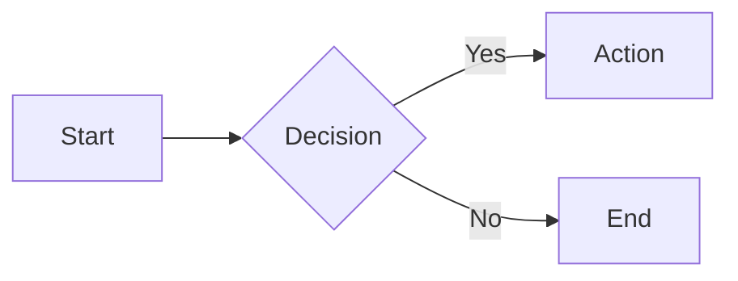

# Mermaid Diagrams

Generate diagrams in markdown that render in GitHub, GitLab, VS Code, Obsidian, Notion.

## Quick Start

````markdown

````

## Quick Decision Tree

```
What to visualize?
├─ Process, algorithm, decision flow    → flowchart
├─ API calls, service interactions      → sequenceDiagram
├─ Database tables, relationships       → erDiagram
├─ OOP, type hierarchy, domain model    → classDiagram
├─ State machine, lifecycle             → stateDiagram-v2
├─ System architecture, services        → flowchart + subgraphs (or C4Context)
├─ Project timeline, sprints            → gantt
├─ User experience, pain points         → journey
├─ Git branches                         → gitGraph
├─ Data distribution                    → pie
└─ Priority matrix                      → quadrantChart
```

## Diagram Types

| Type | Declaration | Best For |
|------|-------------|----------|
| **Flowchart** | `flowchart LR/TB` | Processes, decisions, data flow |
| **Sequence** | `sequenceDiagram` | API flows, service calls |
| **ER** | `erDiagram` | Database schemas |
| **Class** | `classDiagram` | Types, domain models |
| **State** | `stateDiagram-v2` | State machines |
| **Gantt** | `gantt` | Project timelines |
| **Journey** | `journey` | User experience |
| **C4** | `C4Context` | System architecture |
| **Git** | `gitGraph` | Branch visualization |


## Reference Documentation

| File | Purpose |
|------|---------|
| [references/FLOWCHARTS.md](references/FLOWCHARTS.md) | Nodes, edges, subgraphs, styling |
| [references/SEQUENCE.md](references/SEQUENCE.md) | Participants, messages, activation |
| [references/CLASS-ER.md](references/CLASS-ER.md) | Classes, ER diagrams, relationships |
| [references/STATE-JOURNEY.md](references/STATE-JOURNEY.md) | States, user journeys |
| [references/DATA-CHARTS.md](references/DATA-CHARTS.md) | Gantt, Pie, Timeline, Quadrant |
| [references/ARCHITECTURE.md](references/ARCHITECTURE.md) | C4, Block, Kanban |
| [references/CHEATSHEET.md](references/CHEATSHEET.md) | All syntax quick reference |
