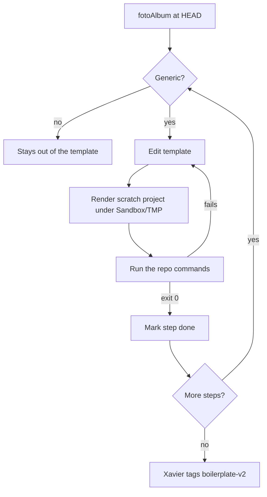

# New webapp template v2

Refresh of the `new-webapp` template (`.claude/skills/new-webapp/template/`) from `Sandbox/fotoAlbum`, from tag `boilerplate-v1` to `boilerplate-v2`. The clones of fotoAlbum carry no tags, so the comparison was file by file: what differs in the generic files, with the domain left out.

## Scope

In: five blocks, all generic and free of photos, albums and slots.

1. Tooling and containers.
2. Backend structure.
3. Frontend rules in its `CLAUDE.md`.
4. Umbrella harness rules.
5. e2e rules in its `CLAUDE.md`.

Out: `react-router`, the components-by-feature layout, `CallSender`, `ReadingView`, `sharp`, fixtures and `DATA_DIR` (decisions of fotoAlbum's domain, not of the skeleton). Dependency upgrades are a later spec.

## Rules of the run

- Each step edits the template, then renders it into a scratch root under `Sandbox/TMP/` with `scripts/render.mjs` and runs the commands of the rendered repos' `CLAUDE.md`. A step is done when they exit 0.
- Every structural change in a backend step keeps `HealthCheck` working end to end; tests move with the code.
- A generic decision of fotoAlbum travels to `template/harness/.claude/decisions/` with its why, and into the index, in the same step as the code it explains. Read the decision before copying; drop what names the domain.
- Docs in the template (`CLAUDE.md` of each repo, harness) are edited after loading `mattpocock-skills:writing-for-agents`.
- `Sandbox/fotoAlbum/` is read-only reference.
- Xavier tags `boilerplate-v2` in the four repos at the end (`! git tag`).

## Steps

- [x] 1. Tooling: backend `Dockerfile` installs from `bun.lock`; `compose.yaml` builds with `network: host`; CI sets `COMPOSE_BAKE`; e2e `up` and `down` scripts; frontend `dev.ts` serves `index.html` on any path and proxies through `proxyTo`. Decisions: the backend image installs its dependencies, bring the stack up for manual checks. Each repo's `CLAUDE.md` follows.
- [x] 2. Backend, transport separate from operations (`Operation`, `JsonOperation`, `JsonTransport`) and routes as a map handed to `Bun.serve` (`Routes`, `OperationRegistry.routes()`). Decisions: transport is separate from operations, routes are a map handed to Bun.serve.
- [x] 3. Backend, errors carry their contract code (`CallError`, `UnreadableCall`) and operations validate inside `execute`. Decisions: errors carry their contract code, operations validate inside execute.
- [x] 4. Backend, `domain/` and `infrastructure/` folders with the import direction rule in its `CLAUDE.md`, and the rule that every `rejects` and `resolves` is awaited. Decision: domain has its own folder, one per concept. Git keeps no empty folders, so the template holds the rule, not the folders.
- [x] 5. Frontend `CLAUDE.md`: testing gotchas (`userEvent.upload`, pending `act` updates), the `cn` import after `shadcn add`, one thing per component, a removed method lists its other effects, project skills read by path.
- [x] 6. Harness `CLAUDE.md`: runtime dependency updates the `Dockerfile`, contract step ends red only on the correspondence test, a later `openapi.yaml` edit repeats the contract step and adds the proxy route, dev servers stop by PID, failed builds leave a container.
- [x] 7. e2e `CLAUDE.md`: deliberate fault for a test with no natural red, a role or label change edits every spec that queries it.
- [x] 8. `SKILL.md`: tag `boilerplate-v2`, what v2 adds, harness decisions note, `.claude/projects.md` or other references fixed.
- [x] 9. Full check: render a scratch project, run every command of step 3 of the skill including `npm run e2e`, compare the rendered tree against the template's expectations. Xavier tags `boilerplate-v2` and removes the scratch root.

## Diagram

