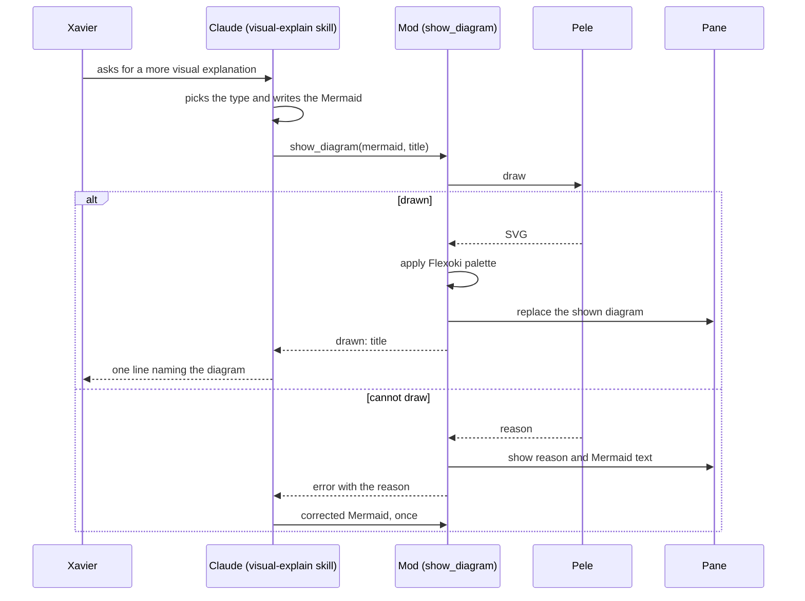

# Visual explain

Docs touched: `.claude/docs/visual-explain.md`. Decisions: `.claude/decisions.md`, area Visual explanation.

Mark a step `- [x]` when its tests pass (`claude plugin test` and `claude plugin validate` in `.claude/skills/visual-explain/`). A step tried by hand is marked only after Xavier confirms.

## Facts verified

- A hooks module may import only its own files and `claude-code`; Pele is bundled to `vendor/pele.js` with esbuild and validates.
- Pele's `render(source)` runs in Node without a browser and returns `{ svg }`; its root `style` reads `--pele-*` variables, so setting them on the root colors the whole diagram.
- The editor draws the `Svg` element as an image: the palette must live inside the SVG.
- The `Svg` source is capped at 131072 characters.

## Steps

- [x] 1. Spike. Pele bundled and imported by a module; validation and a test pass.
- [x] 2. Look. Test-first: a drawn SVG carries the Flexoki variables (paper background, black text, orange accent, series hues) on its root.
- [x] 3. Drawing. Test-first: Mermaid text becomes a shown diagram; text Pele rejects becomes a failure with its reason; an SVG over the size limit is a failure.
- [x] 4. Tool. Test-first: `show_diagram` with `mermaid` and `title` shows the diagram and answers Claude with the title; on failure it answers with the reason as an error.
- [x] 5. Pane. Test-first on the `vscode` surface: the pane draws the latest diagram with its title; a failure draws the reason and the Mermaid text; a new call replaces the old one; the pane opens on the first call.
- [x] 6. Skill. `SKILL.md` with the triggers and the flow: pick the type with `mermaid-diagrams`, write the Mermaid, call `show_diagram`, say one line, retry once on failure.
- [ ] 7. Tried by hand in a PrometeuZZ session: ask for a visual explanation, see the pane; ask again, see it replaced; send a broken diagram, see the failure.

## Diagram

