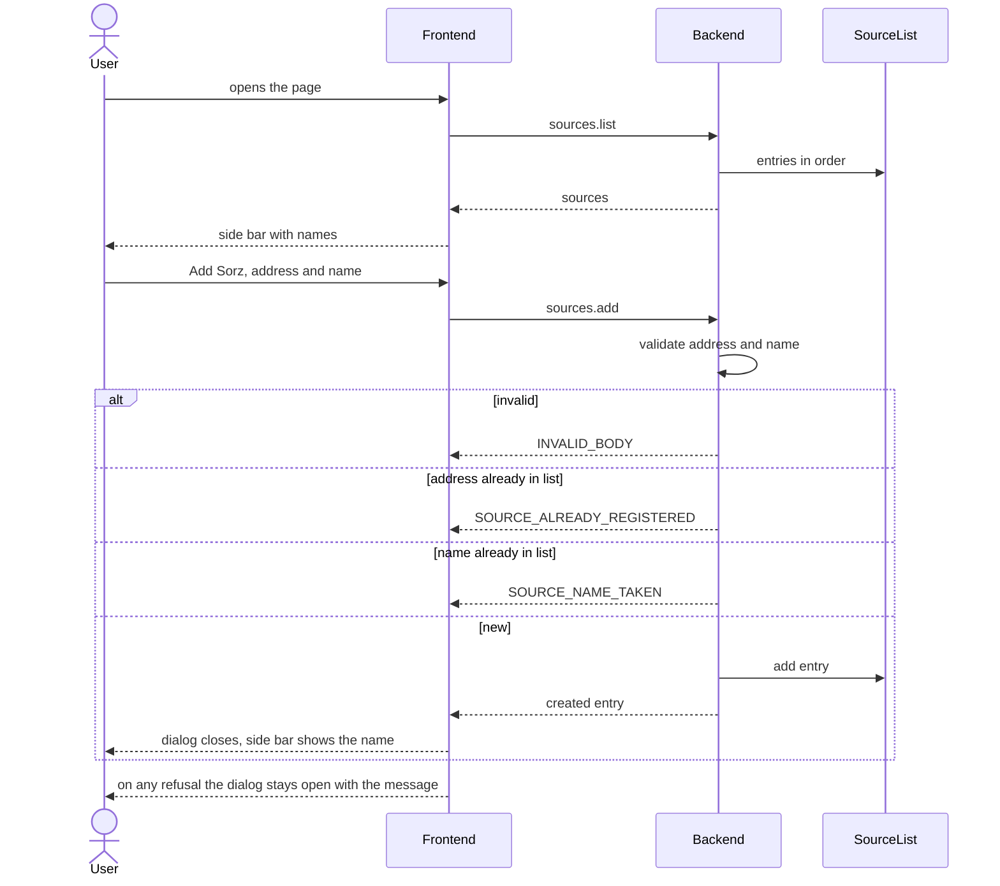

# Add and list sources

Repos: `backend/`, `frontend/`, `e2e/`. Docs: `.claude/docs/source.md`, `.claude/docs/source-list.md`. Decisions: area Sources in `.claude/decisions.md`, plus `operations-validate-inside-execute`, `errors-carry-their-contract-code`, `domain-has-its-own-folder-one-per-concept`.

Goal: an "Add Sorz" button opens a dialog with an address and a name. The backend stores the entry, and a left side bar lists the names in order of addition. Reloading the page shows the list again.

A step is done when its repo's tests, lint and build pass (frontend: also typecheck and `generate:check`); then mark it `- [x]`. Work test-first. Agree the seam once, then run every cycle of a step in one go. A step marked "by hand" is marked only after Xavier confirms it.

## Contract

- `POST /sources.add`: body `address`, `name`. Reply body: the created entry (`sourceId`, `name`, `address`). Errors: `INVALID_BODY`, `SOURCE_ALREADY_REGISTERED`, `SOURCE_NAME_TAKEN`.
- `POST /sources.list`: empty body. Reply body: `sources`, an array of entries in order of addition.
- Both follow Call and Reply with header and body, as `health.check`.

## Target layout

```
backend/src/
  domain/
    source/             Source, SourceAddress, SourceId
    source-list/        SourceList, SourceEntry, SourceName, AddressAlreadyRegisteredError, NameTakenError
  infrastructure/
    InMemorySourceListRepository.ts
  operations/sources/   AddSource.ts, ListSources.ts
frontend/src/
  api/                  AddSource.ts, ListSources.ts
  components/           AddSourceDialog.tsx, SourceSideBar.tsx
e2e/tests/              add-source.spec.ts
```

## Steps

- [x] 1. Contract (backend, then frontend): add both routes and their schemas to `openapi.yaml`, copy it to `frontend/`, run `generate`, add both routes to the `dev.ts` proxy. Ends with the backend correspondence test red only for the new routes and the frontend green.
- [x] 2. Backend domain, test-first: `SourceAddress` (http/https absolute URL, trimmed), `SourceName` (trimmed, required, at most 60), `SourceList.add` refusing a repeated address, then a repeated name ignoring case. Errors extend `CallError` with their codes. No operation yet.
- [x] 3. Backend repository and operations, test-first: `InMemorySourceListRepository` behind an interface the domain owns; `AddSource` and `ListSources` registered in the registry and routes. Covers ok, `INVALID_BODY` for each bad field, both refusals, address before name, and the list in order of addition. Back green, correspondence test green.
- [x] 4. Frontend API, test-first: `AddSource` and `ListSources` wrap the generated client; tests fake fetch. A refusal reaches the caller with its code and message.
- [x] 5. Frontend side bar, test-first: `SourceSideBar` loads on mount and shows loading, the names in order with the address as `title`, the empty text "You have no sources yet", or an error message when `ListSources` fails.
- [x] 6. Frontend dialog, test-first: `AddSourceDialog` opened by the "Add Sorz" button. The submit button is disabled while sending. A refusal or network failure shows its message inside the dialog, which stays open and keeps what was typed. On success the new entry is appended to the side bar from the reply and the dialog closes. Wire both into `App`.
- [x] 7. Look and flow, by hand: Xavier opens the app against the real backend, adds sources, triggers both refusals, reloads and sees the list.
- [x] 8. E2E (`e2e/`): one happy-path test: open the dialog, add a source, see it in the side bar, reload and still see it.

## Out of scope

Renaming, removing, searching, persistence across backend restarts, several users, normalising addresses, checking that the site exists.

## Diagram


