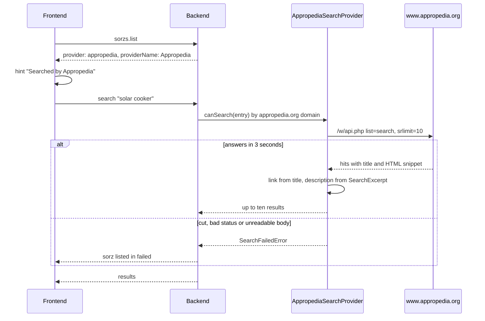

# Appropedia provider

Repos: `backend/`, `frontend/`, `cli/` (contract copy only). Docs: `.claude/docs/search.md`, `.claude/docs/sorz-list.md`, `.claude/docs/backoffice.md`. Decisions: `search-providers-qualify-per-sorz-and-generic-is-the-catch-all`, `a-sorz-has-a-specific-provider-or-the-generic-one`, `the-provider-id-is-free-and-the-reply-names-it`, `the-frontend-has-one-provider-class-and-composes-the-hint`, `geekfeminism-search-reads-the-wiki-api-and-fails-as-wikipedia-does`, `a-geekfeminism-result-has-an-empty-description`, `e2e-covers-the-happy-path-only`. Model: `.claude/specs/geekfeminism-provider.md`.

Goal: the sorz `https://www.appropedia.org` is searched by its own provider, which returns up to ten real results, each with title, link and a description. In the same change the backend describes the provider of each sorz, so a new provider never touches the contract or the frontend again.

A step is done when its repo's tests, lint and build pass (frontend and CLI: also typecheck and `generate:check`); then mark it `- [x]`. Work test-first. Agree the seam once, then run every cycle of a step in one go. A structural step changes no behavior. A step marked "by hand" is marked only after Xavier confirms it. A tidy step is structural and eases the step it names; it runs before it.

## Findings

Measured on 2026-11-20 with `curl` and a browser-like User-Agent:

- Appropedia runs MediaWiki 1.45.5. `https://www.appropedia.org/w/api.php?action=query&list=search&srsearch=<term>&srlimit=10&format=json` answers 200 in about 0.8 s. Each hit in `query.search` carries `title`, `pageid`, `size`, `wordcount`, `timestamp` and a `snippet`.
- The API path is `/w/api.php`; Geek Feminism's is `/api.php`.
- The snippet is HTML: `` around the matches and character references such as `&quot;`. It is a fragment around the matches, without ellipsis, and may carry the leftovers of headings and lists. It is empty when the match is only in the title.
- `appropedia.org` answers 301 to `www.appropedia.org`.
- An article lives at `https://www.appropedia.org/<Title_with_underscores>`, without `/wiki/`. Titles may hold `/` (`Community_action/Join`).
- `prop=extracts` exists, but the intro is empty for pages that open with a list or a template, and it changes the reply to `query.pages[]`. It is not used.
- The provider reads the API only, never `Special:Search`.

## Decisions

Settled with Xavier before the steps; step 2 records each as its own decision file.

1. `SearchProviderId` stops being an `enum`: `provider` is a free `string`, the id. The reply also carries a required `providerName`, the name the sorz is searched by (`Reddit`, `Wikipedia`, `Geek Feminism`, `Appropedia`, `Generic`), in the sorz entry and in each sorz of the census. The change is additive: the frontend and the CLI read `provider` as before.
2. The backend sends names, never screen text. The frontend composes the hint "Searched by {providerName}".
3. The frontend has one `SearchProvider` class, built from `provider` and `providerName`. It answers `isSpecific()` (the id is not `generic`) and `hint()` (empty when generic). The four provider classes and `providerNamed` disappear.
4. The backend `SearchProvider` gains `name()` beside `id()`. `ProviderId` stays a closed union in the domain. The add, list and census operations emit both.
5. The Appropedia provider is for this one wiki. Its id is `appropedia`, its name `Appropedia`, it qualifies with `DomainQualificationStrategy("appropedia.org")` (`www` and any other subdomain count, as with Reddit and Geek Feminism), and it always asks `https://www.appropedia.org/w/api.php`, whatever hostname the entry holds, so no redirect is followed.
6. The link is `https://www.appropedia.org/<title>`: spaces become `_` and every other character is encoded except `_`, `(`, `)`, `/` and `:`.
7. The description is the snippet without tags and with character references decoded. An empty snippet gives `""`, a valid result since `a-geekfeminism-result-has-an-empty-description`. Geek Feminism keeps its empty description: its snippet arrives empty.
8. A class `SearchExcerpt` in `infrastructure/http/` wraps an HTML excerpt and gives its plain text. Wikipedia and Appropedia both use it.
9. The MediaWiki call, the page list and the page are shared between Geek Feminism and Appropedia in `infrastructure/mediawiki/`, parametrized by the API path and the article base. Each provider only configures them. The two provider classes stay apart until a third MediaWiki provider asks for one.
10. Ten results per search; each call is cut at 3 seconds. A cut, a non-success status or an unreadable body means the sorz did not answer (`SearchFailedError`). No hits is an empty result. No slow-down memory. The User-Agent reuses `WIKIPEDIA_CONTACT`.
11. No e2e scenario and no new variable. The CLI only receives the contract copy.

## Steps

Numbered by dependency.

- [x] 1. Change surface analysis, no code: run the `surface-analysis` skill on this spec. Done when Xavier confirms the list and the spec carries the tidies and corrections it found. Result: two reasons for change, the contract describing the provider (steps 3, 4, 5, 12, 13) and the Appropedia provider (steps 6 to 11); tidies at steps 4, 6, 7, 8 and 12.
- [x] 2. Docs and decisions, by hand: write `.claude/docs/appropedia-search.md` (rules: the API read, the link, the description from the snippet, the failure), `.claude/reference/appropedia-api.md` (the findings above), the decisions above in `.claude/decisions/` with their lines in the index (items 1 and 4, 2 and 3, 5 and 10, 7 and 8 each fuse into one file; item 6 and item 9 have their own; item 11 renames `no-e2e-scenario-for-wikipedia-or-geekfeminism` to `no-e2e-scenario-for-a-wiki-provider`), and update `search.md` where a rule changes; `sorz-list.md` and `backoffice.md` need no change, since their hint already reads "Searched by" and the provider's name. The decision about the hint per provider is replaced by the two about `providerName`. Xavier reads them. Marked only after Xavier confirms.
- [x] 3. Contract: in `backend/openapi.yaml` replace the `enum` of `SearchProviderId` with `type: string` (referenced at the sorz entry and at the census sorz) and add the required `providerName` to both (decision 1); copy it to `frontend/` and `cli/`; run `generate` in each. `contract.test.ts` compares route names only and reads no schema, so the backend stays green and only `generate:check` guards the copies. Done when `generate:check`, typecheck, lint, tests and build pass in `frontend/` and `cli/`, and the backend passes all of its own. The CLI changes only its generated `schema.d.ts`. No new route, so the `dev.ts` proxy stays.
- [x] 4. Tidy, backend, structural, eases step 5: `SearchProviders.describedFor(entry)` returns a `ProviderDescription`, a value object whose `toJSON()` gives `{ provider }`. `ListSorzs`, `AddSorz` and `SorzCensus` spread it in place of `idFor(...).toJSON()`; `idFor` is then unused and goes. Protected by `ListSorzs.test.ts`, `AddSorz.test.ts`, `Census.test.ts` and `SorzCensus.test.ts`, which already assert `provider`.
- [x] 5. Backend, names, test-first (decision 4): `SearchProvider.name()` on Reddit, Wikipedia, Geek Feminism, the generic provider and the two test doubles (`StubSearchProvider`, `FakeSearchProvider`); `ProviderDescription` gives `{ provider, providerName }`; `CensusLine` carries `providerName`. Cases in the add, list and census replies: a reddit sorz, a wikipedia sorz, a geekfeminism sorz and a generic one each give their name (`Reddit`, `Wikipedia`, `Geek Feminism`, `Generic`).
- [x] 6. Tidy, backend, structural, eases step 9: `WikipediaPage` moves its tag removal and character-reference decoding into `SearchExcerpt` in `infrastructure/http/` (decision 8). Protected by the excerpt case of `WikipediaSearchProvider.test.ts` (tags, `&quot;`, `&#039;`) and typecheck.
- [x] 7. Tidy, backend, structural, eases step 9: the request, the pages and the page of `infrastructure/geekfeminism/` move to `infrastructure/mediawiki/` as `MediaWikiRequest`, `MediaWikiPages` and `MediaWikiPage`, parametrized by the API path and the article base, with the description still `""` (decision 9). `GeekFeminismSearchProvider` stays and configures them. Search the old names across `src/`, `test/` and `.claude/`, fix every reference and remove what the move leaves empty. Protected by `GeekFeminismSearchProvider.test.ts` (request URL, encoding, User-Agent, links, the five failures) and typecheck.
- [x] 8. Tidy, backend, structural, eases step 11: the fake `web()` of `SearchProvidersFactory.test.ts` answers from a table of hosts to responses, in place of one `if` and one method per host. Protected by that file's existing cases.
- [x] 9. Backend, results, test-first: `ProviderId.appropedia()` and `AppropediaSearchProvider` in `infrastructure/appropedia/`, built on step 7's `mediawiki/` and step 6's `SearchExcerpt`; `MediaWikiPage` gains the description from the snippet (decision 7), which Geek Feminism's empty snippet leaves at `""`. It receives its `fetch` so tests fake the wiki. Cycles: the provider is `appropedia` and `Appropedia`; the request goes to `https://www.appropedia.org/w/api.php` with `srsearch`, `srlimit=10`, `format=json` and the User-Agent, also for an entry whose hostname is `appropedia.org` (decision 5); one result per hit with title and link (decision 6, covering a title with spaces, `/` and `(`); the description is the snippet as plain text, with a `` removed and `&quot;` decoded; an empty snippet gives `""`; no hits give no results; each result carries the sorz as the list shows it; `canSearch` follows the qualification of decision 5 (`appropedia.org`, `www.appropedia.org`, not another domain).
- [x] 10. Backend, failure, test-first (decision 10): a network failure, a cut at 3 seconds, a non-success status and an unreadable body each make the provider throw `SearchFailedError`; `SearchSorzs` already reports that sorz in `failed`. The test that shows the failed sorz next to a working one runs through the real factory, so it lives in step 11.
- [x] 11. Backend, wiring, test-first: `SearchProvidersFactory` registers the provider after Geek Feminism and before the generic one, with the `contact` and `webFetch` it already holds. Nothing but this step's tests catches a provider built and not registered. A test through `SearchSorzs` with a real `SearchProviders` shows an `appropedia.org` and a `www.appropedia.org` sorz get only their own results and never the Google one, and a failing Appropedia is named in `failed` next to a working sorz; add, list and census replies name the provider `appropedia` and `Appropedia`.
- [x] 12. Tidy, frontend, structural, eases step 13: the tests build the entry and census data through one builder in `test/support/` in place of the 44 literals `provider: "..."` spread over nine files (`SorzsSection`, `SorzSideBar`, `SorzsProvider`, `SearchResultList`, `AddSorzDialog`, `SorzEntry`, `ListSorzs`, `AddSorz` and `ListCensus` tests), so `providerName` is added in one place. Protected by those same tests.
- [x] 13. Frontend, test-first (decision 3): one `SearchProvider` class replaces `RedditProvider`, `WikipediaProvider`, `GeekFeminismProvider`, `GenericProvider` and `providerNamed`; `SorzEntry` and `CensusEntry` build it from `provider` and `providerName`. `providerNamed.test.ts` moves its cases to the new class. The mark, the hint "Searched by {providerName}" and the census toggle behave as today for every provider, so the hints asserted in `SorzSideBar.test.tsx`, `SorzsSection.test.tsx`, `SorzEntry.test.ts` and `e2e/tests/provider-mark.spec.ts` stay unedited; an Appropedia sorz shows "Searched by Appropedia" in the list, the collapsed side bar and the census. `ProviderMark` is untouched. Remove what the deletion leaves empty and check the old class names across `src/` and `test/`.
- [x] 14. Real wiki, by hand: Xavier runs the app, registers `https://www.appropedia.org`, searches `solar cooker`, reads the descriptions, follows a result, and stops the network to see the failure line. Marked only after Xavier confirms.

## Out of scope

Extracts through `prop=extracts`, reading `Special:Search`, other wikis of the Appropedia family or other languages, a next page, slow-down memory, an e2e scenario, renaming `WIKIPEDIA_CONTACT`, a closed list of provider ids in the contract, screen text in the backend, a single `MediaWikiSearchProvider` for the two providers.

## Diagram

