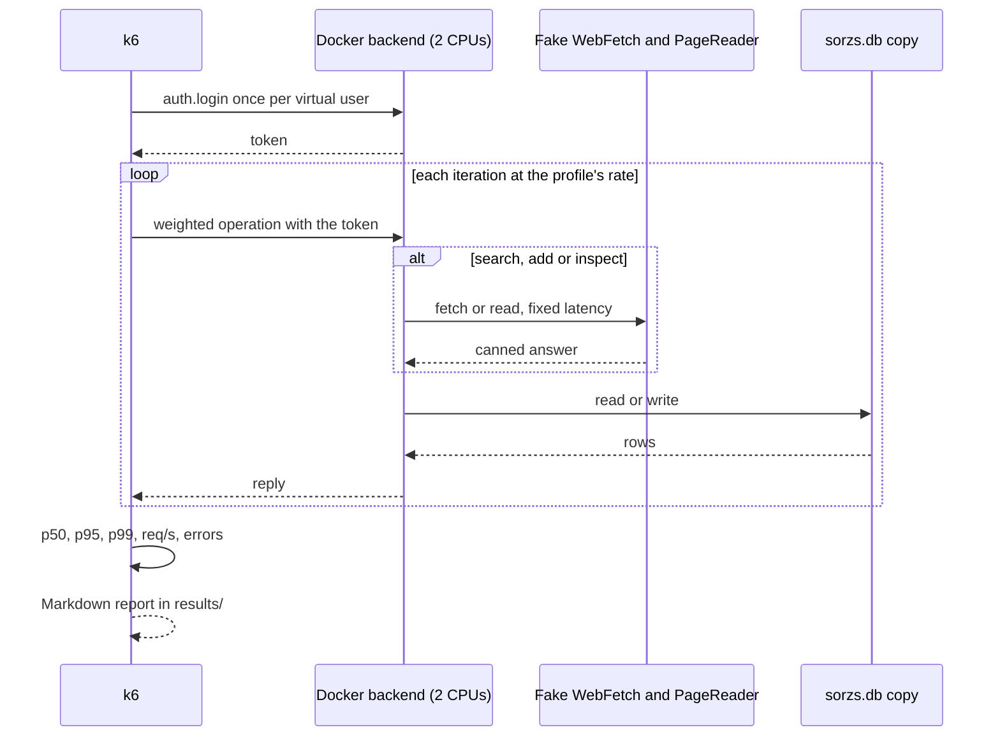

# Backend benchmark

Repo: `backend/` only. No contract change, no frontend, no CLI. Docs: none; the benchmark adds no functional concept. Decisions: none yet; step 5 records the ones that outlive this spec.

Goal: a reproducible baseline of the speed of every backend operation, and the load at which one Bun process with SQLite saturates. Measure only; no optimization in this slice.

A step is done when the backend's tests, lint, typecheck and build pass; then mark it `- [x]`. Work test-first on code under `src/`. A structural step changes no behavior. A step marked "by hand" is marked only after Xavier confirms it. A tidy step is structural and eases the step it names; it runs before it.

## Findings

- Ten operations, all `POST`: `health.check`, `auth.login`, `sorzs.add`, `sorzs.inspect`, `sorzs.list`, `sorzs.search`, `sorzs.census`, `users.list`, `users.add`, `users.setRole`.
- Only the Wikipedia, Geek Feminism and Appropedia providers call the network, through a `WebFetch` they receive from `SearchProvidersFactory`, whose default is the real `fetch`. Reddit and the generic provider only build a link.
- `sorzs.add` and `sorzs.inspect` also call the network: `OperationRegistry.standard` builds `new HttpPageReader()`, which reads the title and favicon through the global `fetch`. With a synthetic address, `sorzs.add` would wait for the 3 second timeout on every iteration and measure that wait. This seam does not exist yet.
- `Password.hashing` calls `Bun.password.hashSync`: a slow hash that blocks the single thread. `auth.login` and `users.add` pay it.
- State lives in `sorzs.db` under `DATA_DIR`. `SEED_USERS` inserts only the usernames the database lacks.
- The `Dockerfile` copies only `src/` and runs `bun run start`, so the image cannot start an entry under `benchmark/`.
- `tsconfig.json` includes `src` and `test` only; Biome checks everything except `dist`.
- `test/operations/sorzs/FakePageReader.ts` answers without latency and lives under `test/`, which `benchmark/` does not import.
- `k6` is not installed on this machine; `docker` is. The sandbox needs `--network host` for `docker run`; `--cpus` still applies.

## Decisions

Settled with Xavier before the steps.

1. Purpose: a baseline against regressions, plus the saturation point. No tuning in this slice.
2. External calls: the benchmark runs through its own start entry in `backend/benchmark/`, which builds the server with a fake `WebFetch` and a fake `PageReader`, both with a fixed latency (default 100 ms) and canned answers. Production code gains no switch. One optional case against the real network, at low load.
3. Tool: `k6`, installed by Xavier outside the project. Scripts in `backend/benchmark/`. Nothing is added to `package.json`.
4. Profiles, a starting point to adjust after the first pass:
   - Medium: 50 virtual users for 2 minutes, 1 s pause between requests.
   - Very high: ramp to 1000 virtual users, no pause.
   - Stress: keep ramping until requests fail or latency passes 1 s.
5. Traffic: one isolated pass per operation, and one mixed scenario. Mixed weights, my assumption since no real traffic exists: `sorzs.search` 50 %, `sorzs.list` 25 %, `sorzs.add` 10 %, `sorzs.inspect` 5 %, `auth.login` 1 %, the remaining 9 % over the other operations (settled in step 9).
6. Environment and metrics: the backend runs in Docker with 2 CPUs on Xavier's machine, from its own image that copies `benchmark/` and starts its entry. Measured: p50, p95, p99, requests per second, error rate, CPU and memory of the container. Results are a local baseline, never production figures.
7. Login: each virtual user logs in once and reuses the token. `auth.login` and `users.add` have their own isolated scenario, where the hash is what is measured.
8. Data: 1000 users with 20 sorzs each, created by a preparation step. Every pass starts from a clean copy of that `sorzs.db`.
9. Writes: `sorzs.add`, `users.add` and `users.setRole` use values unique per iteration (synthetic addresses and usernames), so the success path is measured and not "already exists". The fake `PageReader` is what makes a synthetic address safe.
10. Output: one Markdown report per pass in `backend/benchmark/results/`, with date, commit and profile. The raw k6 JSON is not committed.

## Steps

Numbered by dependency; impact beside each.

- [x] 1. Change surface analysis, no code: run the `surface-analysis` skill on this spec. Done when Xavier confirms the list and the spec carries the tidies and corrections it found. Result: two reasons for change, the server running without the real web (steps 2, 3, 5) and the measuring kit (steps 4, 6 to 11); tidies at steps 2, 3 and 4.
- [x] 2. Tidy, backend, structural, eases step 5: `OperationRegistry.standard` receives the `PageReader` in place of building `new HttpPageReader()`; `Server.start` and `main.ts` pass it. Impact: medium. Protected by `contract.test.ts`, `server.test.ts` and typecheck.
- [x] 3. Tidy, backend, structural, eases step 5: `SearchSettings` receives an optional `WebFetch` and hands it to `SearchProvidersFactory`; the real `fetch` stays the default. Impact: medium. Protected by `SearchSettings.test.ts` and `SearchProvidersFactory.test.ts`.
- [x] 4. Tidy, structural, eases step 5: `tsconfig.json` includes `benchmark/`, so its TypeScript is typechecked. Impact: low. Protected by `bun run typecheck`.
- [x] 5. Backend, benchmark entry, test-first (decision 2): `backend/benchmark/` holds a start entry that builds the server with a fake `WebFetch` and a fake `PageReader` with configurable fixed latency (default 100 ms). Cases: with the fakes, `sorzs.search` on a wiki sorz and `sorzs.add` on a synthetic address answer after about the latency and without touching the network; with a latency of 0 they answer at once. Record decisions 2 and 7 as their own files in `.claude/decisions/`, with their lines in the index. Impact: high; without it no run is trustworthy.
- [x] 6. Image, by hand (decision 6): a `Dockerfile` for the benchmark that copies `src/` and `benchmark/` and starts the entry of step 5, and a way to run it with 2 CPUs and `--network host`. Impact: medium. Marked after Xavier confirms the container answers `health.check`.
- [x] 7. Data, by hand (decision 8): a script creates the 1000 users and their 20 sorzs each through the API and saves the clean `sorzs.db`; `.gitignore` covers the raw k6 output. Impact: medium. Marked after Xavier confirms the counts.
- [x] 8. Isolated scenarios, by hand: Xavier installs `k6`; one script per operation at the medium profile against the container (decisions 4, 6, 7, 9). Impact: high. Marked after Xavier confirms every operation answers and the error rate is read.
- [x] 9. Mixed scenario, by hand: the weighted scenario at the medium, very high and stress profiles; this step fixes how the remaining 9 % is split (decisions 4, 5). Impact: high. Marked after Xavier confirms the saturation point is visible.
- [x] 10. Report, by hand: the Markdown report per pass and the first baseline in `results/` (decision 10). Impact: medium. Marked after Xavier reads it.
- [ ] 11. Real network, by hand: one low-load case against the real providers, never part of the baseline. Xavier runs it when he wants; it calls Wikipedia and other sites. Impact: low. Marked after Xavier confirms.

## Out of scope

Optimizing anything the benchmark shows, caching, another database, several processes, the frontend and the CLI, running in CI, production figures, a benchmark of the real providers under load, reusing the test doubles of `test/`.

## Diagram

