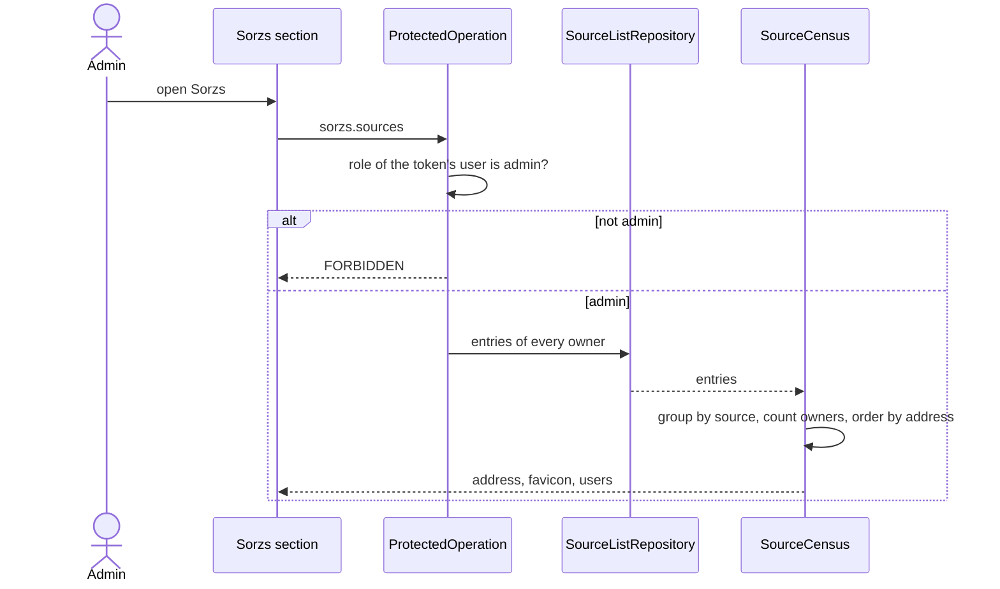

# Backoffice Sorzs

Repos: `backend/`, `frontend/`, `e2e/`. Docs: `.claude/docs/backoffice.md`, `.claude/docs/source.md`, `.claude/docs/source-list.md`, `.claude/docs/user.md`. Decisions: areas "Contract", "Backend structure" and "Frontend API" in `.claude/decisions.md`, plus `the-sorzs-section-reads-a-source-census`, `the-source-list-repository-hands-over-every-owners-entries`, `the-users-section-operations-require-the-admin-role`, `source-and-list-entry-are-separate-concepts`, `title-and-favicon-belong-to-the-source-the-name-stays-optional`, `a-missing-part-is-a-null-object-not-null`, `action-buttons-show-an-icon-never-text`, `e2e-covers-the-happy-path-only`.

Goal: `xaviuzz`, the admin, sees in the Sorzs section every source that is in the list of at least one user, ordered by address, each with its favicon, its address and how many users have it; the service refuses the operation to anyone who is not an admin.

A step is done when its repo's tests, lint, typecheck and build pass; then mark it `- [x]`. Work test-first. Agree the seam once, then run every cycle of a step in one go. A step marked "by hand" is marked only after Xavier confirms it.

## Rules

- Operation: `sorzs.sources` (POST, empty body, resource `sorzs`) answers `{ sources: [{ address, favicon, users }] }`, already ordered. `favicon` is a string or null in the contract only; `users` is a number. Requires admin through `AdminAccess`; any other user, or a missing token, gets `FORBIDDEN`.
- `SourceCensus` (domain) is built from every owner's entries: it groups them by source, counts distinct owners and orders by address ignoring case, scheme included. It leaves out sources no list holds. The favicon is the source's, a null object when missing.
- `SourceListRepository` gains a read of every owner's entries; `InMemorySourceListRepository` and `SqliteSourceListRepository` implement it. The census is tested with the in-memory repository.
- Frontend: `api/sorzs/` holds `ListSorzsSources`, throwing refusals like the other wrappers. A `SorzsSourcesProvider` owns the list. `SourceFavicon` moves to the nearest folder shared by the source list and the backoffice.
- Screen, as in `backoffice.md`: under the title, a row per source with favicon (globe when missing), the address in full and, on the right, the number of users with accessible name "N users" ("1 user" for one) and a tooltip. No buttons, no links. A failed read shows its message alone; an empty census shows the title and an empty list.
- E2E, happy path only: `xaviuzz` and a user he adds in the backoffice (`ana` is left alone: `multiuser.spec.ts` expects her list empty) register sources, one in common; `xaviuzz` opens the backoffice, chooses Sorzs and sees the sources in address order, the common one with 2 users and the others with 1.

## Target layout

```
backend/src/
  domain/source-list/       SourceCensus; SourceListRepository gains the read of all owners
  infrastructure/memory/    InMemorySourceListRepository
  infrastructure/sqlite/    SqliteSourceListRepository
  operations/sorzs/         ListSorzsSources
frontend/src/
  api/sorzs/                ListSorzsSources
  components/backoffice/sorzs/  SorzsSourcesProvider, SorzsSection, SorzsSourceRow
  components/sources/       SourceFavicon (moved up if not already shared)
e2e/tests/                  backoffice-sorzs.spec.ts
```

## Steps

- [x] 1. Docs and decisions, done with this plan: `backoffice.md`, `source.md`, two decision files with their index lines. Done when Xavier approves them.
- [x] 2. Contract: `sorzs.sources` in `openapi.yaml`, copy to `frontend/`, regenerate the client, add the route to the `dev.ts` proxy. Done when only the backend correspondence test is red and `frontend/` passes `generate:check`, lint, typecheck, test and build.
- [x] 3. Backend, domain and storage, test-first: `SourceCensus` groups by source, counts distinct owners, orders by address ignoring case with `http://` before `https://`, keeps `https://a.com` and `https://a.com/` apart and is empty with no entries; both repositories hand over every owner's entries.
- [x] 4. Backend, operation, test-first: `sorzs.sources` answers as in Rules, refuses a plain user and a missing token with `FORBIDDEN`, and the registry serves the route; the correspondence test turns green.
- [x] 5. Frontend, API, test-first with a fake `fetch`: `ListSorzsSources` sends the right call, returns the sources with a null object for a missing favicon, throws the refusals.
- [x] 6. Frontend, screen, test-first with a fake `fetch`: rows show favicon, address and count in the order given; a missing favicon shows the globe; the count has its accessible name; a failed read shows only its message; an empty census shows no rows; a `FORBIDDEN` answer sends the user to the entry screen.
- [x] 7. E2E: `backoffice-sorzs.spec.ts` as in Rules. Done when the whole suite passes.
- [x] 8. By hand: bring the stack up (`bring-the-stack-up-for-manual-checks`), enter as `xaviuzz`, register sources as `xaviuzz` and `ana`, open Sorzs and check order, favicons, globe and counts, remove one from a list and see the count fall.

## Out of scope

Seeing which users have a source, removing sources of other users, opening a source, pagination, health.

## Diagram


