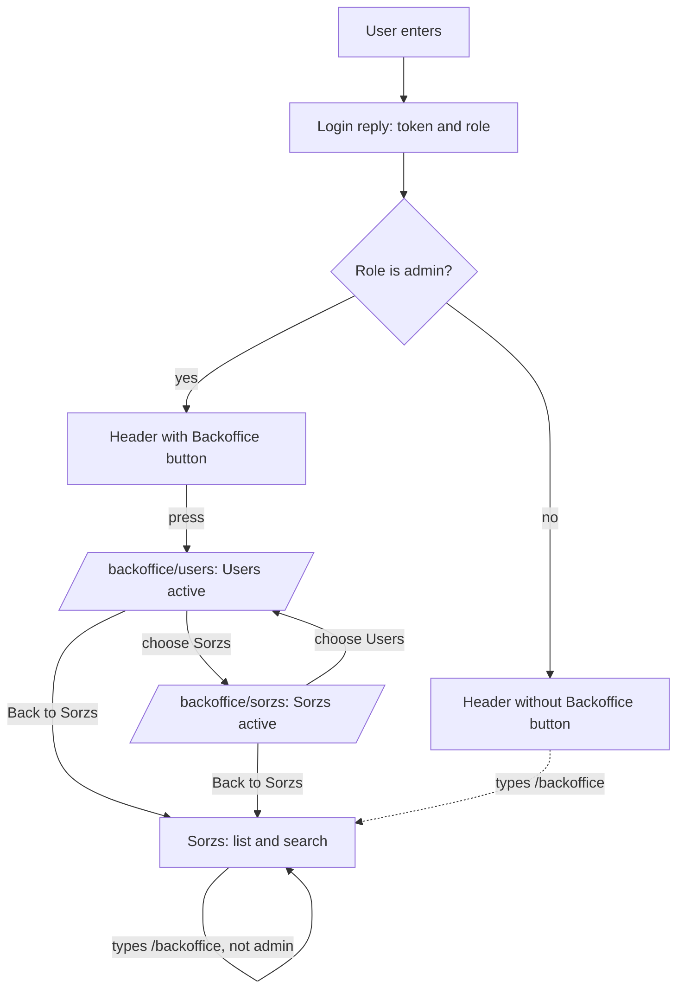

# Backoffice start

Repos: `backend/`, `frontend/`, `e2e/`. Docs: `.claude/docs/backoffice.md`, `.claude/docs/user.md`, `.claude/docs/session.md`. Decisions: areas "Contract", "Backend" and "Frontend API" in `.claude/decisions.md`, plus `a-seed-user-may-carry-a-role`, `the-login-reply-carries-the-role`, `the-backoffice-lives-at-a-path-without-a-router`, `backend-protection-of-the-backoffice-waits-for-its-first-operation`, `users-come-from-one-seed-users-variable`, `the-session-keeps-the-token-in-localstorage`, `e2e-covers-the-happy-path-only`.

Goal: `xaviuzz`, the admin, enters a backoffice frame from a header button; it has a header, a side bar with Users and Sorzs, and a title per section.

A step is done when its repo's tests, lint, typecheck and build pass; then mark it `- [x]`. Work test-first. Agree the seam once, then run every cycle of a step in one go. A step marked "by hand" is marked only after Xavier confirms it.

## Rules

- `SEED_USERS` pairs take an optional third field, the role (`admin` or `user`, default `user`). Another role refuses the start. Development and e2e set `xaviuzz:p1casso:admin,ana:pueblos`.
- `auth.login` answers with the token and `role`. The frontend keeps the role beside the token in the same store. A stored token without a role is a `user`.
- No backend operation is added and none is protected by role; the first backoffice operation does that.
- Paths: `/backoffice` goes to `/backoffice/users`; `/backoffice/users` and `/backoffice/sorzs` show their section; a non-admin at any `/backoffice` path goes to `/`. History API, no new dependency.
- Header: in Sorzs, an admin sees an icon-only `Shield` button, accessible name "Backoffice", with a tooltip, left of Log out. In the backoffice, the header holds the brand (not a link), the health mark, an icon-only `ArrowLeft` button named "Back to Sorzs" with a tooltip, and Log out. No search box, no add button.
- Side bar: Users (`Users` icon) and Sorzs (`Globe` icon), the active one marked, icon-only when collapsed. The main panel shows only the active title.
- E2E: `xaviuzz` enters, opens the backoffice, sees "Users", chooses Sorzs and sees "Sorzs", goes back and sees the source list. A user who is not an admin not seeing the button, and the redirect from `/backoffice`, are frontend tests with a fake `fetch`.

## Target layout

```
backend/src/
  domain/user/              Role; Users reads the optional third field
  operations/auth/          login answers with role
frontend/src/
  domain/                   Role; Session keeps the role with the token
  components/header/        BackofficeButton, BackToSorzsButton, Header by area
  components/backoffice/    BackofficeScreen, BackofficeSideBar, section titles, path handling
e2e/tests/                  backoffice.spec.ts
```

## Steps

- [x] 1. Docs and decisions, done with this plan: `backoffice.md`, `user.md`, `session.md`, the line in `CLAUDE.md`, four decision files with their index lines. Done when Xavier approves them.
- [x] 2. Contract: `role` in the `auth.login` reply in `openapi.yaml`, copy to `frontend/`, regenerate the client. Done when only the backend correspondence test is red and `frontend/` passes `generate:check`, lint, typecheck, test and build.
- [x] 3. Backend, test-first: `Role`; `SEED_USERS` with and without the third field and the start failing on an unknown role (update `.env` samples and the `Dockerfile` if they read the variable); `auth.login` answers with the user's role for `xaviuzz` and `ana`.
- [x] 4. Frontend, test-first with a fake `fetch`: the session keeps and forgets the role with the token, and a stored token without a role is a user; the header shows the Backoffice button only to an admin; the Back to Sorzs button returns; the backoffice header has no search box and no add button; a non-admin at `/backoffice` goes to `/`; `/backoffice` goes to `/backoffice/users`; choosing an entry in the side bar marks it active, shows its title and changes the path; the dev server and its proxy serve the app at `/backoffice` paths.
- [x] 5. E2E: `xaviuzz:p1casso:admin` in the Compose files; `backoffice.spec.ts` as in Rules. Done when the whole suite passes.
- [x] 6. By hand: bring the stack up (`bring-the-stack-up-for-manual-checks`), enter as `xaviuzz` and open the backoffice, switch sections, reload on each and see the same one, go back; enter as `ana` and see no button, then type `/backoffice` and land on the app.

## Out of scope

Anything inside the Users and Sorzs sections beyond their titles, backend protection by role, more roles, creating users, a router library.

## Diagram


