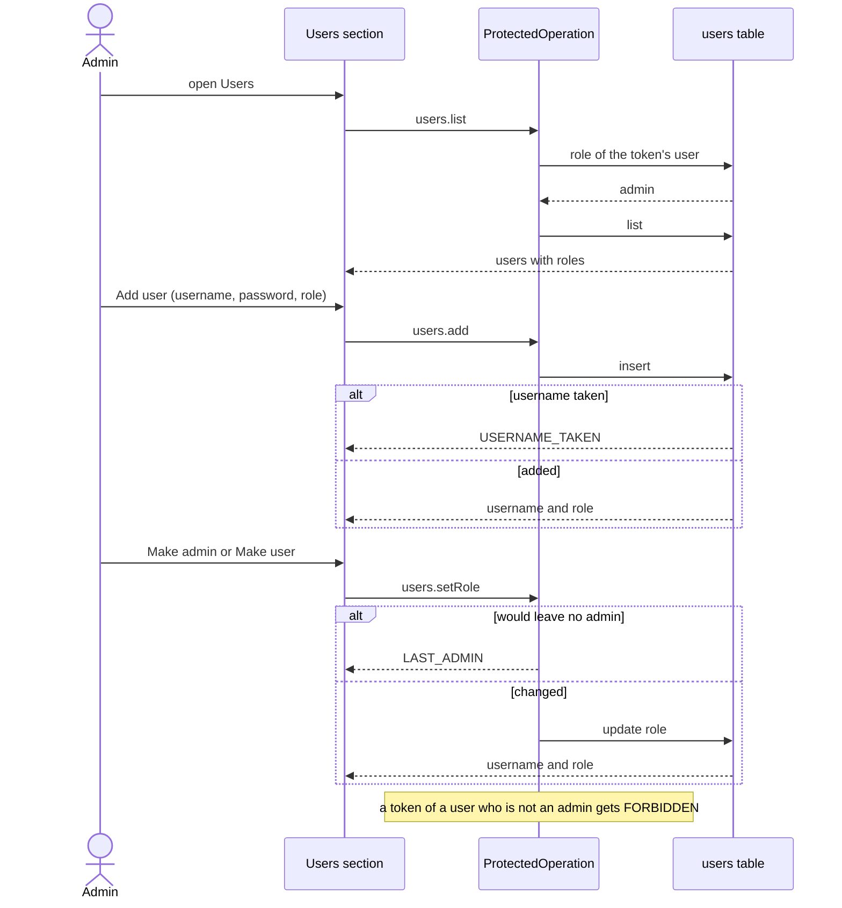

# Backoffice users

Repos: `backend/`, `frontend/`, `e2e/`. Docs: `.claude/docs/user.md`, `.claude/docs/backoffice.md`, `.claude/docs/session.md`. Decisions: areas "Contract", "Backend structure" and "Frontend API" in `.claude/decisions.md`, plus `users-persist-in-sqlite-and-the-seed-only-adds-the-missing`, `the-users-section-operations-require-the-admin-role`, `the-last-admin-cannot-be-made-a-user`, `sorzs-provider-owns-the-reading-dialog-reports-onadded`, `the-add-form-empties-when-the-dialog-closes`, `e2e-covers-the-happy-path-only`.

Goal: `xaviuzz`, the admin, sees every user in the Users section, adds a user and changes a role; the service refuses these operations to anyone who is not an admin, and users live in SQLite.

A step is done when its repo's tests, lint, typecheck and build pass; then mark it `- [x]`. Work test-first. Agree the seam once, then run every cycle of a step in one go. A step marked "by hand" is marked only after Xavier confirms it.

## Rules

- Operations, all POST, grouped as resource `users`: `users.list` (empty body) answers `{ users: [{ username, role }] }`; `users.add` takes `{ username, password, role }` and `users.setRole` takes `{ username, role }`, both answer the affected `{ username, role }`. No reply carries a password or a hash.
- Errors: `USERNAME_TAKEN` and `LAST_ADMIN` are new codes, each with its own error in the domain. An unknown role, a blank username or password on `add`, or `setRole` on an unknown username, is `INVALID_BODY` with a message.
- `ProtectedOperation` takes the role an operation requires. For admin it reads the role from `Users` on every call and answers `FORBIDDEN` otherwise. The three operations require admin; the rest stay open to any user.
- Users live in a `users` table of `sorzs.db` (username, password hash, role, insertion order). `SqliteUsers` implements `Users`, which gains list, add and set role. `InMemoryUsers` stays for tests. On start, each `SEED_USERS` entry whose username is absent is inserted; existing ones are untouched. A database that cannot be read stops the start, as for sorzs.
- Making the last admin a user is refused with `LAST_ADMIN`; an admin may demote themself while another remains.
- Frontend: `api/users/` holds `ListUsers`, `AddUser`, `SetRole`, throwing refusals like the other wrappers. A `UsersProvider` owns the list and offers `add` and `setRole`. The `Role` of the frontend domain gains what the screen needs (the opposite role, the label of its button).
- Screen, as in `backoffice.md`: toolbar with an icon-only "Add user" button (user icon with a plus); a row per user with username, role and one icon-only button, "Make admin" (shield with up caret) or "Make user" (shield with down caret); dialog with Username, Password, Role (user by default), Add and Cancel; the form empties when the dialog closes; refusals show their message in the dialog or beside the row; a failed read shows its message alone.
- Icon buttons carry a tooltip and an accessible name, like the header's.
- E2E, happy path only: `xaviuzz` opens the backoffice, sees `xaviuzz` and `ana` with their roles, adds a user, and that user enters with the password given. Role change, the last admin and the refusal for a non-admin are backend and frontend tests.

## Target layout

```
backend/src/
  domain/user/              Users (list, add, set role), UsernameTakenError, LastAdminError, the admin check on Role or User
  infrastructure/sqlite/    SqliteUsers, users table, seed that adds the missing
  operations/users/         ListUsers, AddUser, SetRole
  operations/auth/          ProtectedOperation with the required role
frontend/src/
  api/users/                ListUsers, AddUser, SetRole
  components/backoffice/users/  UsersProvider, UsersSection, UsersToolbar, UserRow, AddUserDialog
e2e/tests/                  backoffice-users.spec.ts
```

## Steps

- [x] 1. Docs and decisions, done with this plan: `user.md`, `backoffice.md`, `session.md`, the line in `CLAUDE.md`, three decision files with their index lines, the replaced decision. Done when Xavier approves them.
- [x] 2. Contract: the three operations and the two error codes in `openapi.yaml`, copy to `frontend/`, regenerate the client, add the routes to the `dev.ts` proxy. Done when only the backend correspondence test is red and `frontend/` passes `generate:check`, lint, typecheck, test and build.
- [x] 3. Backend, domain and storage, test-first: `Users` lists, adds (refusing a taken username) and sets a role (refusing the last admin) in memory and in SQLite; the seed adds only the missing and leaves an existing user's role; the users survive a restart; the start fails on an unreadable database.
- [x] 4. Backend, operations, test-first: `ProtectedOperation` refuses with `FORBIDDEN` a valid token whose user is not an admin on the three operations, and a role change counts on the next call; the operations answer as in Rules; the sorzs operations still serve a plain user; the registry serves the routes; the correspondence test turns green. Update the `Dockerfile` and `.env` samples if needed.
- [x] 5. Frontend, API, test-first with a fake `fetch`: the three wrappers send the right call, return the user, throw the refusals.
- [x] 6. Frontend, screen, test-first with a fake `fetch`: the list shows every user with role and the one button that applies; Add user opens the dialog, adds, closes, empties and shows the row; a taken username shows its message in the dialog; the role button changes the row and a `LAST_ADMIN` refusal shows beside it; a failed read shows only its message; the icon buttons have the accessible names in Rules; a `FORBIDDEN` answer sends the user to the entry screen.
- [x] 7. E2E: `backoffice-users.spec.ts` as in Rules. Done when the whole suite passes.
- [x] 8. By hand: bring the stack up (`bring-the-stack-up-for-manual-checks`), enter as `xaviuzz`, see both users, add one and enter as them, make `ana` an admin and back, try to make the only admin a user and read the refusal, restart the backend and see the users and roles kept.

## Out of scope

Removing or renaming users, changing passwords, the Sorzs section, more roles, the sorzs of other users.

## Diagram


