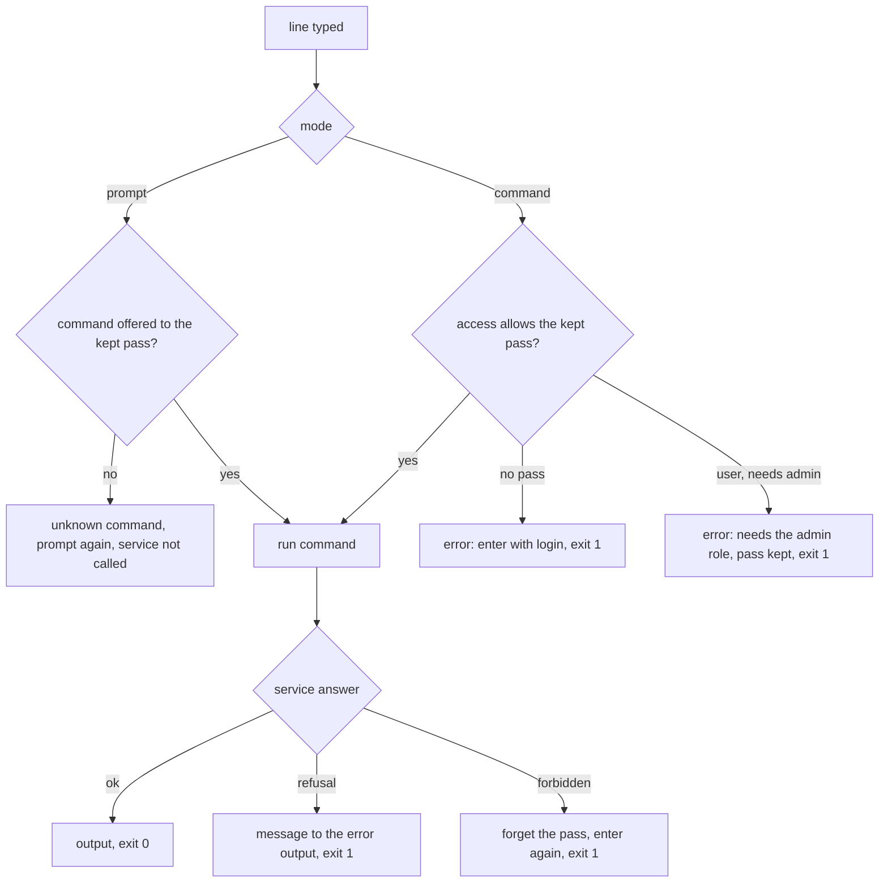

# CLI: all operations, by role

Repo: `cli/`. Docs: `.claude/docs/cli.md` (section "Commands and who may use them"), `.claude/docs/session.md`, `.claude/docs/user.md`, `.claude/docs/source-list.md`, `.claude/docs/backoffice.md`. Decisions: area "CLI" in `.claude/decisions.md`, mainly `a-cli-command-declares-who-may-use-it`, `commands-are-named-by-what-they-do`, `command-mode-checks-the-role-before-calling`, `each-cli-command-describes-itself-and-help-reads-them`, `api-operations-are-grouped-by-resource-like-the-backend`, `the-cli-builds-its-client-on-every-call`.

Goal: every operation of the service is a CLI command, and in the prompt the user is offered only the commands they may use now. The contract does not change; the CLI already holds its pinned copy.

A step is done when the `cli/` tests, lint, typecheck, build and generate:check pass; then mark it `- [x]`. Work test-first. Agree the seam once per step, then run every cycle of the step in one go. A step marked "by hand" is marked only after Xavier confirms it.

## Rules

The rules are in `.claude/docs/cli.md`: the table and the lists under "Commands and who may use them", plus the lines on `help`, unknown commands and Tab in "Rules in prompt mode" and on the role in "Rules in command mode".

- Seam to agree at step 1: how the registry knows who is asking. Proposal: each command comes with an `Access` (`AnyoneAccess`, `SessionAccess`, `AdminAccess`) that answers `allows(pass)`; `Commands` reads the kept pass from `PassStore` on every call and keeps only the allowed commands in `lines()`, `names()` and the lookup.
- Seam to agree at step 2: where the command-mode check lives. Proposal: the registry of command mode runs the same `Access` before `run` and fails with one of two messages; the pass is never forgotten by it.
- Seam to agree at step 3: one API wrapper per resource (`ApiSources`, `ApiHealth`), each call through `Refusable` and `CallId` as `ApiLogin` does; a forbidden answer goes to `Session.forbidden`, a refusal to `Terminal.fail` with the service's message.
- Seam to agree at step 4: `ApiUsers` and `ApiSorzs` the same way; `adduser` takes its password from the line in command mode and from `Terminal`'s hidden read in the prompt, two commands behind one name registered per mode.

## Steps

- [ ] 1. Access in the prompt: the commands that exist today (`help`, `login`, `backend`, `exit` for anyone; `logout` for a session) are offered by state. `help`, Tab and the unknown-command answer agree; they change as soon as the user enters or leaves. A command that is not offered is unknown and calls nothing.
- [ ] 2. Role in command mode: a command whose access does not allow the kept pass fails, saying "enter with login" with no pass and "needs the admin role" with a user's pass; the pass is kept. `help` lists every command except `exit`.
- [ ] 3. User commands: `health`, `add`, `list`, `inspect`, `search`, with their usage lines, outputs and refusals as in the table. They are registered in both modes.
- [ ] 4. Admin commands: `users`, `adduser`, `setrole`, `census`, same way. `adduser` asks for the password without echo in the prompt, never remembers it, and reads it from the line in command mode.
- [ ] 5. Wire `main.ts` with both registries, rebuild `dist/sorzs`, and cover one smoke test that runs the compiled build with a new command and checks the exit code.
- [ ] 6. By hand, with the stack up: `bun run install:bin`; enter as `ana` and as `xaviuzz` and compare `help` and Tab; `sorzs users` with `ana`'s pass fails saying it needs the admin role and keeps the pass; `add`, `list`, `inspect` and `search` against the stack; `adduser` and `setrole` as `xaviuzz`.

## Out of scope

Removing or renaming sources and users, changing passwords, JSON output, completing arguments, help for a single command, refreshing the role without entering again.

## Diagram

