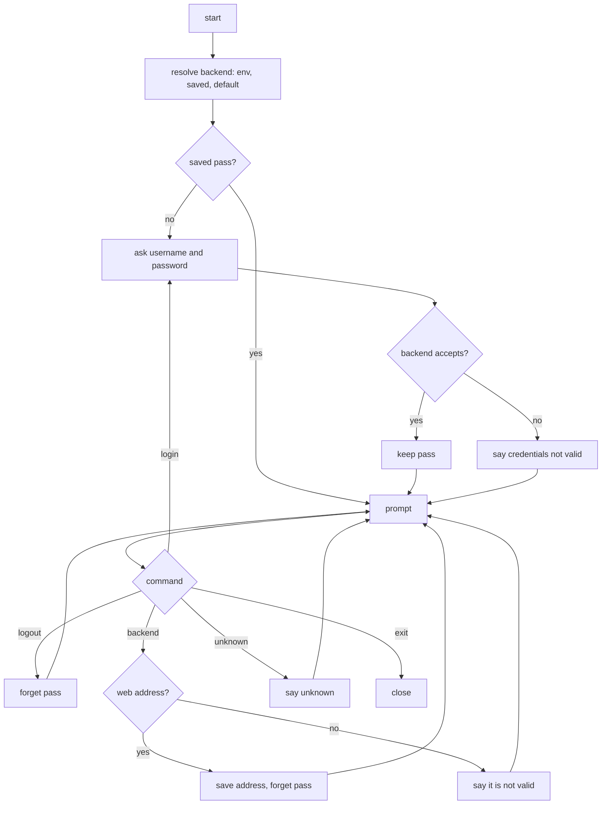

# CLI boilerplate

Repos: `cli/` (new), `e2e/` untouched. Docs: `.claude/docs/cli.md`, `.claude/docs/session.md`. Decisions: area "CLI" in `.claude/decisions.md`, plus `logout-only-forgets-the-token-in-the-browser`, `generated-client-openapi-typescript-and-openapi-fetch`, `the-token-travels-in-the-authorization-header`, `api-wrappers-throw-refusals-and-let-network-failures-through`.

Goal: a new repo `Sorzs-cli`, cloned as `cli/`, with an open prompt that knows where the backend lives, asks for authorization on start, and offers `login`, `logout`, `backend` and `exit`.

A step is done when its repo's tests, lint, typecheck and build pass; then mark it `- [x]`. Work test-first. Agree the seam once, then run every cycle of a step in one go. A step marked "by hand" is marked only after Xavier confirms it.

## Rules

- The rules of the program are in `.claude/docs/cli.md`; this spec does not repeat them.
- Stack: Bun, TypeScript, `bun test`, Biome, `tsc --noEmit`. Runtime dependencies: `openapi-fetch` only; dev: `openapi-typescript`, Biome, TypeScript. Prompts use `node:readline`; the password is read with echo off. Add nothing else without asking.
- The contract is a pinned copy of `openapi.yaml` from `backend/`; the client is generated from it, with `generate` and `generate:check` scripts as in `frontend/`. This slice uses only `auth.login`.
- State lives in the folder `SORZS_HOME`, default `~/.config/sorzs/`: `config.json` for the backend address and `token` for the pass, mode 0600. `SORZS_BACKEND` overrides the saved address. Tests pass a temporary `SORZS_HOME`; none touches the real `$HOME`.
- Tests fake the terminal (lines in, lines out), `fetch` and the folder. No e2e and no CI deploy in this slice; CI runs the same gates as the other repos.
- The cross-repo contract step now copies `openapi.yaml` to `frontend/` and `cli/`.

## Target layout

```
cli/src/
  domain/        Backend (address), Pass, Credentials, Session, Command (interface), commands: Login, Logout, SetBackend, Exit, Unknown
  api/           Login wrapper over the generated client
  infrastructure/
    terminal/    ReadlineTerminal, Terminal (interface the domain owns)
    files/       FolderConfig, FolderPassStore
  main.ts        wiring and start
cli/test/        mirrors src/
```

## Steps

- [x] 1. Docs and decisions, done with this plan: `cli.md` and the "CLI" area. Done when Xavier approves them.
- [x] 2. Umbrella: `CLAUDE.md` now says four repos and the contract copy goes to `frontend/` and `cli/`; fix the references by name in `.claude/`. Done when Xavier approves the diff.
- [x] 3. Repo `cli/`: `package.json`, `tsconfig.json`, `biome.json`, scripts `test`, `lint`, `typecheck`, `build`, `generate`, `generate:check`, a `CLAUDE.md` with stack and commands, the CI workflow as in `backend/` plus `generate:check`, one smoke test. Xavier creates the GitHub repo and clones it into `Sorzs/cli/`. Done when the four commands pass.
- [x] 4. Contract: copy `openapi.yaml`, run `generate`. Done when `generate:check` passes.
- [ ] 5. Backend address, test-first: `Backend` rejects what is not a web address; resolution order environment, saved, default; `backend` shows and saves; saving forgets the pass.
- [ ] 6. Session, test-first with a fake `fetch`: `Login` wrapper; `Session` enters with good credentials and keeps the pass; refused credentials leave no session and say the credentials are not valid; a 403 forgets the pass and asks again; `logout` deletes it.
- [ ] 7. Prompt loop, test-first with the fake terminal: asks for authorization on start when there is no pass; shows the prompt; dispatches `login`, `logout`, `backend`, `exit`; unknown commands; `exit` ends the loop; the password is not echoed.
- [ ] 8. Wiring and `bin`: `main.ts` with the real terminal and folder; `bun run start` opens the prompt.
- [ ] 9. Decisions: confirm each file of the "CLI" area still matches what was built.
- [ ] 10. By hand: bring the backend up (`bring-the-stack-up-for-manual-checks`), start the CLI, enter, close, reopen and see it skip the login, `backend` to a new address, `logout`, `exit`.

## Out of scope

Everything listed under "Out of scope" in `.claude/docs/cli.md`.

## Diagram


