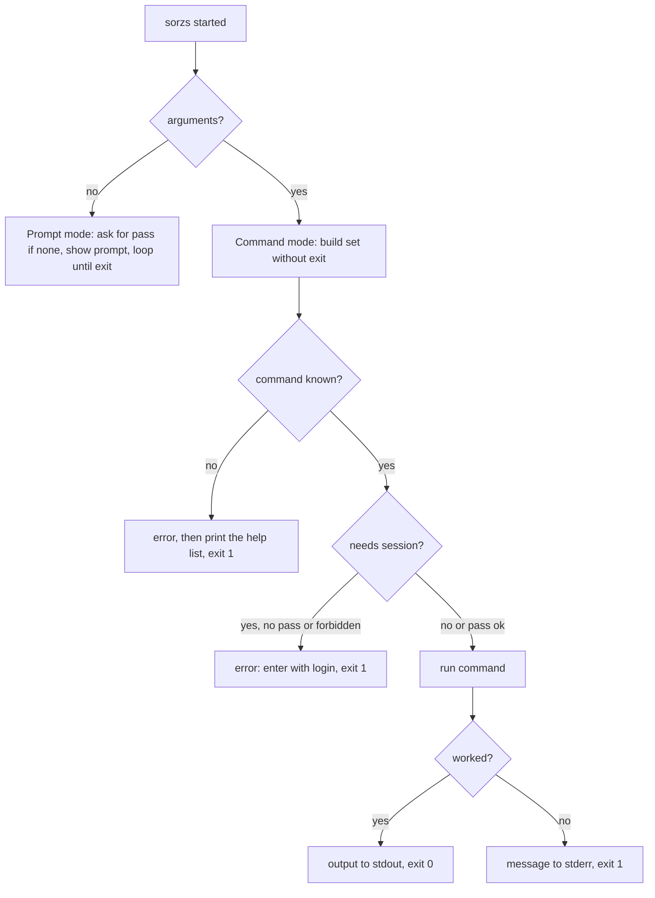

# CLI command mode

Repo: `cli/`. Docs: `.claude/docs/cli.md`, `.claude/docs/session.md`. Decisions: area "CLI" in `.claude/decisions.md`, mainly `the-cli-has-a-prompt-mode-and-a-command-mode`, `each-cli-command-describes-itself-and-help-reads-them`, `the-cli-keeps-its-state-in-one-folder`, `the-cli-ships-as-a-compiled-executable-beside-the-plain-build`.

Goal: `sorzs <command> [arguments]` runs one command and ends, so an agent or script can call each command from a shell with no prompt. `sorzs` alone keeps opening the prompt. `help` shows the usage of the mode it runs in.

A step is done when the `cli/` tests, lint, typecheck, build and generate:check pass; then mark it `- [x]`. Work test-first. Agree the seam once, then run every cycle of a step in one go. A step marked "by hand" is marked only after Xavier confirms it.

## Rules

The rules are in `.claude/docs/cli.md`, sections "Rules in command mode" and "Rules in prompt mode". Nothing changes in prompt mode except what `help` prints, which stays as it is today.

- Seam to agree at step 1: how a command reports failure. Proposal: `Terminal` gains `fail(line)`, written to the error output; the command-mode run asks nothing back and takes its exit code from a `Failures` object that `fail` marks, read once at the end by `main.ts`.
- Seam to agree at step 2: how the mode changes names and the command set. Proposal: `Commands` takes a `Typing` strategy (`PromptTyping` writes `name`, `ShellTyping` writes `sorzs name`) and each mode registers its own set (`exit` only in the prompt's). Each command still describes itself; `help` asks the registry.
- Seam to agree at step 3: how `login` takes its credentials. Proposal: `EnvironmentLoginCommand` beside `LoginCommand`, reading `SORZS_USER` and `SORZS_PASSWORD` from a given environment; both call `Session.enter`.

## Target layout

```
cli/src/
  domain/          Typing (PromptTyping, ShellTyping); Failures; EnvironmentLoginCommand; CommandMode (runs one line, ends)
  infrastructure/terminal/   error output for fail
  main.ts          no arguments: Prompt; arguments: CommandMode with its own registry
cli/test/          mirrors src
```

## Steps

- [x] 1. Failure and exit code, test-first with the terminal faked: `fail` writes to the error output; `CommandMode` runs the given line and reports 0 when nothing failed, 1 when something did; an unknown command fails. The prompt also sends unknown commands to the error output. `main.ts` takes the code in step 5.
- [x] 2. Mode-aware `help`: `ShellTyping` prefixes `sorzs `; command mode has no `exit` (typing it is unknown); `help`, `--help` and `-h` print the list; an unknown command prints the list and fails; prompt `help` output is unchanged.
- [x] 3. `login` in command mode: reads `SORZS_USER` and `SORZS_PASSWORD`; fails naming the missing one; a refused login, an unreachable service and a good login set the exit code accordingly; its help line says it reads the environment.
- [x] 4. No session in command mode: nothing asks anything; a command that needs a session fails asking for `login` when there is no pass or the service refuses it as forbidden (the refused pass is forgotten); `logout` and `backend` work with no session. No history is written and no Tab is offered. No command needs a session yet, so the rule of failing without one waits for the first source command; `forbidden` and a bad backend address already fail.
- [x] 5. Wire `main.ts` on arguments, rebuild `dist/sorzs`, and cover one smoke test that runs the compiled build with an argument and checks the exit code.
- [x] 6. By hand: `bun run install:bin`, then `sorzs help`, `sorzs backend`, `SORZS_USER=... SORZS_PASSWORD=... sorzs login`, `sorzs logout`, `sorzs nonsense; echo $?`, and `sorzs` alone still opens the prompt.

## Out of scope

JSON output, several commands in one run, reading credentials from flags or standard input, help for a single command, completing arguments, the source commands.

## Diagram


