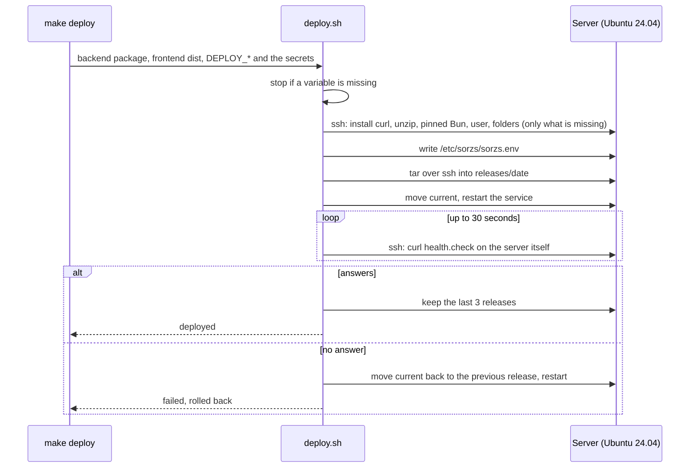

# Deploy over ssh

Repos: `backend/` only. The frontend contributes its `dist`, passed to the script as a path. Docs: none; this is infrastructure, no business rule changes. Decisions: `one-bun-serves-front-and-api-deployed-over-ssh`, `ci-gates-and-no-deploy`, `backend-tooling-bun-native-plus-biome`, `a-missing-part-is-a-null-object-not-null`.

Goal: one command deploys Sorzs to an Ubuntu 24.04 server over ssh, with no containers on it. It is first proven against an Ubuntu 24.04 container on this machine; a GitHub Action will later run the same script against the real server.

A step is done when its repo's tests, lint and build pass; then mark it `- [x]`. Work test-first where there is code to test. A structural step changes no behavior. A step marked "by hand" is marked only after Xavier confirms it. A tidy step is structural and eases the step it names; it runs before it.

## Rules

The rules are in `.claude/decisions/one-bun-serves-front-and-api-deployed-over-ssh.md`; this spec adds none.

## Decisions

Settled with Xavier in the surface analysis; step 2 records them in that decision file.

1. With `STATIC_DIR` set, a `GET` to an operation URL still answers 404, as today; only other `GET`s fall to the files.
2. The secrets `AUTH_SECRET`, `WIKIPEDIA_CONTACT` and `SEED_USERS` reach the script as variables of the caller. Every deploy writes them to `/etc/sorzs/sorzs.env` (mode 600, root only), which the service reads. The script stops before touching the server if one is missing. Locally `make` supplies the e2e values; the GitHub Action will take them from secrets.
3. The test server uses `--network host`: sshd listens on 2222 and the app on 3001. The app port is the variable `APP_PORT` (default 3000); `DEPLOY_PORT` is only ssh.
4. `health.check` is asked from the server itself, by `curl` over ssh, retried for 30 seconds. No app port needs to be open to the outside.
5. The package is `src`, `package.json`, `bun.lock`, a production `node_modules` made in a temporary folder with `bun install --production --frozen-lockfile`, and the frontend `dist`. It starts from source like the `Dockerfile`, not from the bundle.
6. `.bun-version` in `backend/` is the origin of the Bun version. `ci.yml` and the deploy read it; the `Dockerfile` keeps its literal in `FROM` (Docker cannot read a file there) and a `lint:bun-version` script fails when they differ. Frontend and CLI keep their own version: they are independent repos.

## Steps

Numbered by dependency. A tidy step shows beside it the step it eases.

- [x] 1. Change surface analysis, no code: run the `surface-analysis` skill on this spec. Done when Xavier confirms the list and the spec carries the tidies and corrections it found.
- [ ] 2. Decision, by hand: `one-bun-serves-front-and-api-deployed-over-ssh` and its line in the index are written with decisions 1 to 6 above, and the notes that said "waits for a target" point to it. Marked only after Xavier reads them and confirms.
- [ ] 3. Tidy T1, backend, eases step 4: the `404` fallback of `Server` (`fetch: () => new Response(null, { status: 404 })` in `server.ts`) becomes a named class, `NotFoundFallback`, so the static one is its second implementation. Done when the tests `an unknown URL answers 404` and `a GET to an operation URL answers 404` of `server.test.ts` pass unchanged.
- [ ] 4. Backend, behavior, test-first: `STATIC_DIR` makes the server serve the files in that folder and answer any other `GET` with its `index.html`. The setting follows `AuthSettings.fromEnv`; without the variable it is a null object and the server behaves as before. `Server.start` and the SUT of `server.test.ts` gain the setting. Cycles: without the variable a `GET` to an unknown URL answers 404; a `GET` of an existing file returns it with its content type; a `GET` of an unknown path returns `index.html`; a `GET` to an operation URL answers 404 (decision 1); a `POST` to an operation reaches the operation; a path that climbs out of the folder (`..`) does not read outside it. Update the backend `CLAUDE.md` with the variable.
- [ ] 5. Tidy A, backend, eases step 7: `.bun-version` holds `1.4.3`; `ci.yml` uses `bun-version-file: .bun-version`; the `lint:bun-version` script in `package.json` fails when the `FROM` of the `Dockerfile` does not contain it. Check in the documentation of `oven-sh/setup-bun@v2` that `bun-version-file` reads `.bun-version` before writing it. Done when `bun run lint` passes, and fails after changing either number by hand.
- [ ] 6. Test server, by hand: `backend/deploy/` holds an Ubuntu 24.04 image with systemd and an sshd on 2222, run with `--network host` (decision 3); the `Makefile` has `server-up` and `server-down`, and `server-up` creates a temporary ssh key outside the repo. Risk to settle first: systemd must boot inside the container in this sandbox (cgroups v2); if it cannot, stop and propose a VM instead. Done when `ssh` into the container works with that key and `server-down` leaves no container behind (`docker ps -a`).
- [ ] 7. Deploy script, by hand: `backend/deploy/deploy.sh` takes `DEPLOY_HOST`, `DEPLOY_USER`, `DEPLOY_PORT`, `DEPLOY_KEY`, `APP_PORT`, the three secrets and the path of the frontend `dist`, and stops at once if one is missing. It installs `curl`, `unzip` and the Bun of `.bun-version` when missing, creates the unprivileged user, `DATA_DIR` and `STATIC_DIR`, writes `/etc/sorzs/sorzs.env`, copies the package of decision 5 with `tar` over ssh into `releases/<date>`, moves `current`, restarts the systemd service, waits for `health.check` as decision 4 says, and on no answer moves `current` back to the previous release. It keeps the last 3 releases. Done when it passes `shellcheck` and Xavier confirms.
- [ ] 8. Verification, by hand: `make deploy` builds nothing, fails with a clear message when the frontend `dist` is missing, and otherwise packs the backend and that `dist` and runs the script against the test server. Done when, on a clean server, the first deploy works and the page and an operation answer over HTTP on `APP_PORT`; a second deploy changes nothing it should not and keeps `sorzs.db`; a deliberately broken release makes the script return `current` to the previous one.

## Out of scope

The GitHub Action and its secrets, TLS and the `www` and `api` subdomains (Caddy), the backup of `sorzs.db`, changing the e2e frontend from the dev server to this topology, the same Bun version for `frontend/` and `cli/`, `@types/bun` being ahead of the runtime.

## Diagram

