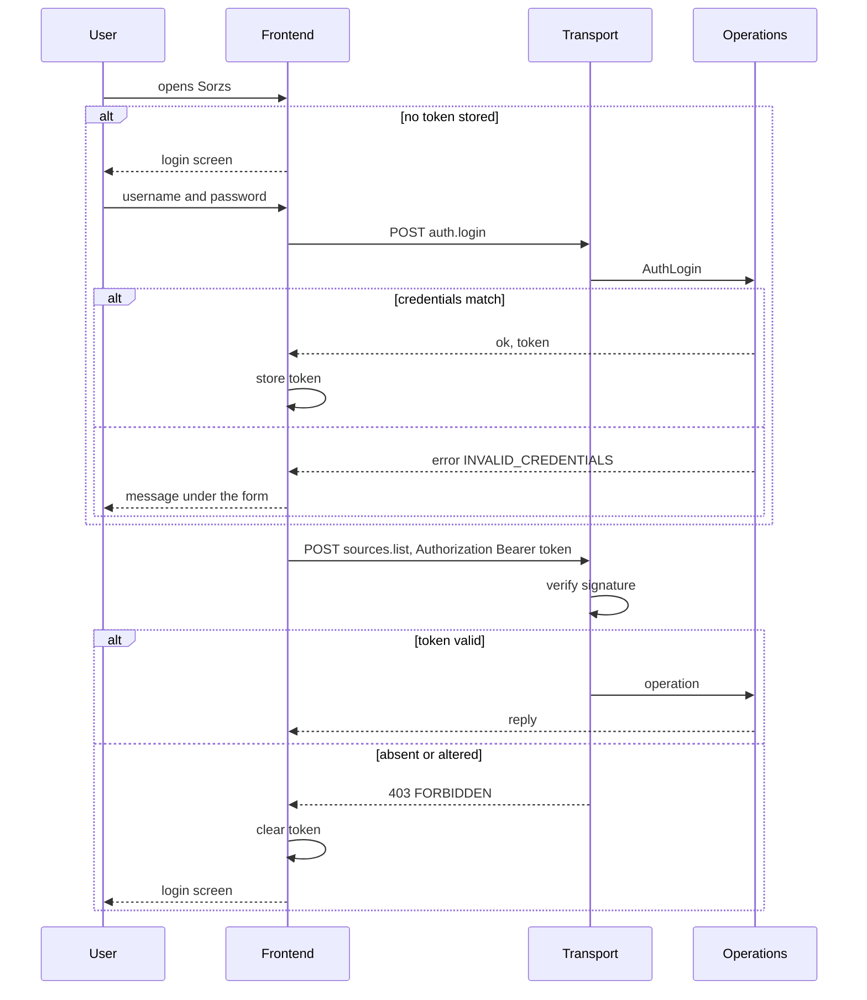

# Login

Repos: `backend/`, `frontend/`, `e2e/`. Docs: `.claude/docs/user.md`, `.claude/docs/session.md`, `.claude/docs/source-list.md`. Decisions: areas "Contract" and "Backend" in `.claude/decisions.md`, plus `errors-live-in-the-message`, `rpc-api-not-rest`, `the-page-reader-is-an-interface-the-domain-owns`, `the-api-reaches-components-through-one-apiprovider`, `e2e-covers-the-happy-path-only`.

Goal: only a logged-in user reaches the API. One user, `xaviuzz`. The backend issues a signed token at login; the frontend sends it on every call and returns to the login screen when the API answers 403.

A step is done when its repo's tests, lint, typecheck and build pass; then mark it `- [x]`. Work test-first. Agree the seam once, then run every cycle of a step in one go. A step marked "by hand" is marked only after Xavier confirms it.

## Rules

- `auth.login` takes `{ username, password }` and answers `{ token }`. Wrong credentials answer 200 with `status: error`, code `INVALID_CREDENTIALS` and one message that does not say which field failed.
- Every route except `health.check` and `auth.login` answers 403 without a valid token: the standard error body, code `FORBIDDEN`. The check runs in the transport, before the `Call` is read; operations never see the token. This extends `errors-live-in-the-message`: 403 joins 400, 404 and 500 as a transport failure.
- The token travels as `Authorization: Bearer <token>`. It is signed with HMAC from `AUTH_SECRET`, carries the username, and does not expire. `crypto` ships with Bun: no new dependency.
- `Users` is an interface the domain owns, with an in-memory implementation. The password is stored hashed with `Bun.password`. The user is seeded from `SEED_USER` and `SEED_PASSWORD`; `src/` holds no literal credentials. Development and e2e set `xaviuzz` and `p1casso`. The backend refuses to start without `AUTH_SECRET`, `SEED_USER` and `SEED_PASSWORD`.
- The source list is unchanged and not tied to a user.
- Frontend: a middleware on the `openapi-fetch` client, built in `ApiProvider`, adds the header and tells the session on a 403. Operation classes do not change. `SessionProvider` sits above `SourcesProvider`, keeps the token in `localStorage` behind an interface (tests use an in-memory one), and renders the login screen while there is no token. A 403 clears the token; the providers below unmount and the list and search reset.
- The login screen has the brand, username, password (type password), a button, Enter submits, and the refusal message inline in the style of `AddSourceMessage`. No header, side bar or health mark. A 403 shows no message.
- E2E: one happy-path test of logging in, and a shared login helper for the existing specs. Wrong credentials, a bad token and the return to login are tested in `backend/` and `frontend/`.

## Target layout

```
backend/src/
  domain/user/              User, Users (interface), Password, Token, TokenSigner (interface)
  infrastructure/memory/    InMemoryUsers
  infrastructure/crypto/    HmacTokenSigner
  operations/auth/          AuthLogin
  call/ or transport        bearer check before the Call is read
frontend/src/
  api/auth/                 Login
  api/                      token middleware in ApiProvider
  components/session/       SessionProvider, TokenStore (interface), LoginScreen, LoginForm
e2e/tests/                  login.spec.ts, login helper
```

## Steps

- [x] 1. Docs, done with this plan: `user.md`, `session.md` and the line in `source-list.md`. Done when Xavier approves them.
- [ ] 2. Contract, `backend/` then `frontend/`: `auth.login` with its call and reply, `INVALID_CREDENTIALS` and `FORBIDDEN` codes, the 403 response on every protected route. Copy `openapi.yaml` to `frontend/`, run `generate`, add `/auth.login` to the `dev.ts` proxy. Done when only the correspondence test is red in the backend and `generate:check`, lint, typecheck, test and build pass in the frontend.
- [ ] 3. Backend, test-first: `User` and `Password` (hash and match); `Users` behavior suite against `InMemoryUsers`; `Token` signing and reading with `HmacTokenSigner` (an altered token and a token from another secret are refused); `AuthLogin` (good and bad credentials); the bearer check in the transport (absent, malformed, altered, valid; `health.check` and `auth.login` stay open); wiring from `AUTH_SECRET`, `SEED_USER`, `SEED_PASSWORD`, failing at start when one is missing. Update `.env` samples and the `Dockerfile` if it reads them. The correspondence test turns green.
- [ ] 4. Frontend, test-first with a fake `fetch`: `Login` in the API wrappers and `useLogin`; the middleware (header present when there is a token, session told on 403); `SessionProvider` with the in-memory store (no token shows the login screen, a good login shows the app, a 403 returns to the login screen with the token cleared, a stored token skips the screen); `LoginForm` (fields, Enter, inline refusal). `App` renders inside the session.
- [ ] 5. E2E: `SEED_USER`, `SEED_PASSWORD` and `AUTH_SECRET` in the Compose files; the login helper used by the existing specs; `login.spec.ts` logs in with `xaviuzz`/`p1casso` and sees the app. Done when the whole suite passes.
- [ ] 6. Decisions: record, one file each with its line in the index: errors extended to 403 for a missing or bad token; the token in `Authorization: Bearer`; signed token without expiry; users behind an interface with a seed from the environment; the session keeps the token in `localStorage`.
- [ ] 7. By hand: bring the stack up (`bring-the-stack-up-for-manual-checks`), reload the page while logged in, edit the token in `localStorage` and confirm the return to login.

## Out of scope

Log out, expiry, more users, tying the list to a user, failed-attempt limits, SQLite for users, cookies.

## Diagram


