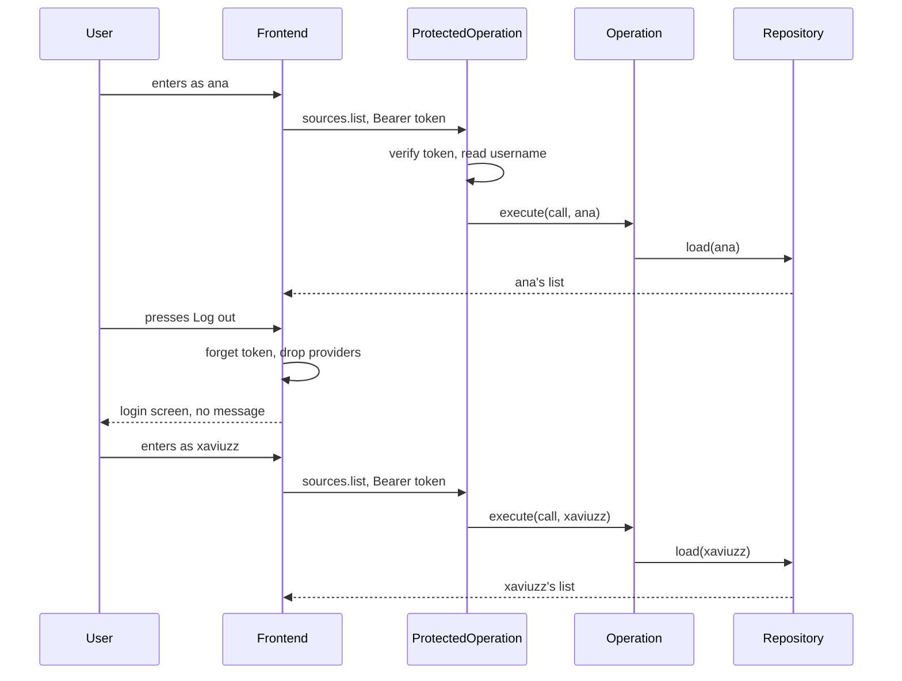

# Multiuser and logout

Repos: `backend/`, `frontend/`, `e2e/`. Docs: `.claude/docs/user.md`, `.claude/docs/session.md`, `.claude/docs/source-list.md`, `.claude/docs/search.md`. Decisions: areas "Backend", "Sources, domain" and "Frontend API" in `.claude/decisions.md`, plus `users-come-from-one-seed-users-variable`, `each-entry-row-carries-its-owner`, `logout-only-forgets-the-token-in-the-browser`, `the-token-travels-in-the-authorization-header`, `e2e-covers-the-happy-path-only`, `persistence-is-not-tested-in-e2e`.

Goal: two users, `xaviuzz` and `ana`, each with a personal list; the frontend gets a logout icon button.

A step is done when its repo's tests, lint, typecheck and build pass; then mark it `- [x]`. Work test-first. Agree the seam once, then run every cycle of a step in one go. A step marked "by hand" is marked only after Xavier confirms it.

## Rules

- `SEED_USERS` is `username:password` pairs separated by commas and replaces `SEED_USER` and `SEED_PASSWORD`. The backend refuses to start without it, `AUTH_SECRET` or a well-formed pair. Development and e2e set `xaviuzz:p1casso,ana:pueblos`.
- The username comes only from the verified token, never from a body. `ProtectedOperation` already verifies the token; it now also hands the username on, so `sources.list`, `sources.add` and `sources.search` act on that user's list; `sources.inspect` does not touch a list and is unchanged. The contract does not change.
- Seam to agree at step 2: how the username reaches the handler. Proposal: `TokenSigner` gains `userOf(raw)`, and `ProtectedOperation` passes the username to the handler as a second argument of `execute(call, owner)`; open operations ignore it.
- `SourceListRepository` loads and adds for an owner. Address and name rules apply within one owner's list; the same address can be in two lists.
- SQLite: an `owner` column; reads and writes filter by it; the position of addition counts per owner. On start, rows without the column are migrated with `xaviuzz`. Unreadable file still fails the start and leaves the file untouched. The in-memory repository keeps one list per owner; one behavior suite runs against both.
- Logout: no operation, no contract change. `Session` already forgets the token on a 403; logout calls the same method. Providers below `SessionProvider` unmount, so the list and the search reset.
- The logout button is an icon-only button at the right of the header, next to the add button, with `aria-label` "Log out" and a tooltip. It shows no username.
- E2E: one test, `xaviuzz` logs in, adds a source, logs out; `ana` logs in and sees the empty list, logs out.

## Target layout

```
backend/src/
  domain/user/              Users reads SEED_USERS pairs; TokenSigner.userOf
  domain/source-list/       SourceListRepository takes the owner
  infrastructure/memory/    InMemorySourceListRepository per owner
  infrastructure/sqlite/    owner column and migration
  operations/               ProtectedOperation hands the username on; sources.* use it
frontend/src/
  domain/                   Session.leave (the forget path under another name)
  components/header/        LogoutButton in Header
e2e/tests/                  multiuser.spec.ts, login helper takes the user
```

## Steps

- [x] 1. Docs and decisions, done with this plan: `user.md`, `session.md`, `source-list.md`, `search.md`, the line in `CLAUDE.md`, three decision files with their index lines. Done when Xavier approves them.
- [x] 2. Backend, test-first: `SEED_USERS` parsing and the start failing on a missing or malformed value (update `.env` samples and the `Dockerfile` if it reads the old names); `TokenSigner.userOf` (valid, altered); the repository behavior suite per owner against both implementations (two owners do not see each other, the same address in two lists, name clash only inside one list, position per owner); the SQLite migration (old rows go to `xaviuzz`, a file that cannot be read still fails); `ProtectedOperation` hands the username on; `sources.list`, `sources.add`, `sources.search` act on the token's user; `ana` and `xaviuzz` isolated through the operations.
- [ ] 3. Frontend, test-first with a fake `fetch`: `Session.leave` forgets the token and tells listeners; `LogoutButton` in the header (icon, accessible name "Log out", click returns to the login screen with no message, and the next login reads the list again); the header shows it beside the add button.
- [ ] 4. E2E: `SEED_USERS` in the Compose files in place of the old pair; the login helper takes the user; `multiuser.spec.ts` as in Rules. Done when the whole suite passes.
- [ ] 5. By hand: bring the stack up (`bring-the-stack-up-for-manual-checks`), enter as `xaviuzz`, add a source, log out, enter as `ana` and see an empty list, restart the backend on an old `sorzs.db` and confirm `xaviuzz` keeps the old sources.

## Out of scope

Creating or removing users, changing passwords, revoking a token on the service, showing the username, sharing lists between users, source suggestions.

## Diagram


