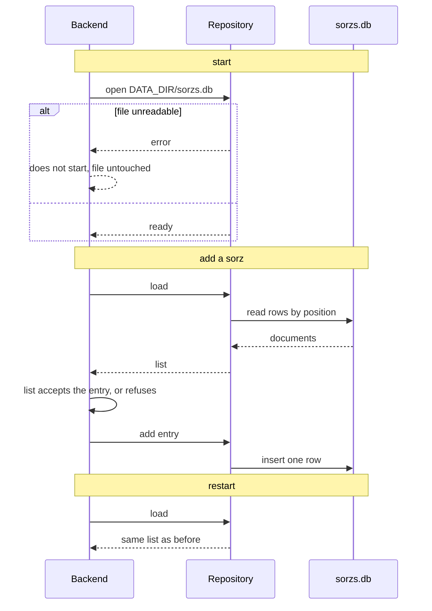

# Persist sorzs

Repos: `backend/`, `e2e/`. Docs: `.claude/docs/sorz-list.md`. Decisions: area "Sorzs, domain" in `.claude/decisions.md`, plus `the-backend-image-installs-its-dependencies`, `e2e-compose-uses-host-networking`.

Goal: the sorz list survives a restart. The backend stores it in one SQLite file, a JSON document per entry, in a folder that Docker keeps as a volume. No contract change, no frontend change.

A step is done when its repo's tests, lint, typecheck and build pass; then mark it `- [x]`. Work test-first. Agree the seam once, then run every cycle of a step in one go. A step marked "by hand" is marked only after Xavier confirms it.

## Rules

- `bun:sqlite` is the store: no new dependency. The file is `sorzs.db` inside `DATA_DIR`; the image defaults it to `/data`, development to `./data`, which git ignores.
- One row per entry: its position of addition and its JSON document. `add(entry)` writes one row; `load()` rebuilds the list in position order.
- The repository interface is `load()` and `add(entry)`; `save` is gone. `AddSorz` loads the list, lets the list accept the entry, then adds it to the repository.
- A file that cannot be opened or read stops the start with a clear error and is not touched.
- `InMemorySorzListRepository` stays as the double for tests. One behavior suite runs against both implementations; the SQLite one also runs it on a temporary file closed and reopened.
- The e2e Compose mounts no volume, so every `compose up` starts with an empty list.

## Target layout

```
backend/src/
  domain/sorz-list/       SorzListRepository (load, add)
  infrastructure/memory/    InMemorySorzListRepository
  infrastructure/sqlite/    SqliteSorzListRepository
  operations/               OperationRegistry builds the repository from DATA_DIR
backend/test/               repository behavior suite shared by both implementations
backend/Dockerfile          /data as a volume
e2e/tests/                  persistence.spec.ts
```

## Steps

- [x] 1. Docs and decisions: `sorz-list.md` says the list is kept for good; the decision on persistence is replaced and the repository decision recorded. Done when the three files and the index agree.
- [x] 2. Structural, backend: the interface becomes `load()` and `add(entry)`; `InMemorySorzListRepository` and `AddSorz` follow; `save` goes. No behavior change; the existing tests stay green.
- [x] 3. Shared behavior suite, backend, test-first: an empty repository loads an empty list; entries added come back in order of addition; a loaded list refuses a repeated address and name. It runs against the in-memory implementation.
- [x] 4. `SqliteSorzListRepository`, backend, test-first from the same suite: it passes on `:memory:`; on a temporary file, closing and reopening keeps the list; a corrupt file fails on open and stays byte for byte as it was.
- [x] 5. Wiring, backend: `OperationRegistry` builds the SQLite repository from `DATA_DIR`; the `Dockerfile` creates `/data` and declares it a volume; `data/` goes into `.gitignore`. Check the image: build it, run it with `-v` on a free port, add a sorz, restart the container, list it (umbrella `CLAUDE.md`, "Verifying containers and servers").
- [x] 6. E2E, dropped: the specs run in the Playwright container, which cannot restart the backend. The backend suite and the image check cover persistence; why in `decisions/persistence-is-not-tested-in-e2e.md`. The `e2e/CLAUDE.md` line on where the list lives is updated.

## Out of scope

Renaming and removing entries (each will add its own method to the repository), several lists or users, backups, a database server, migrations.

## Diagram


