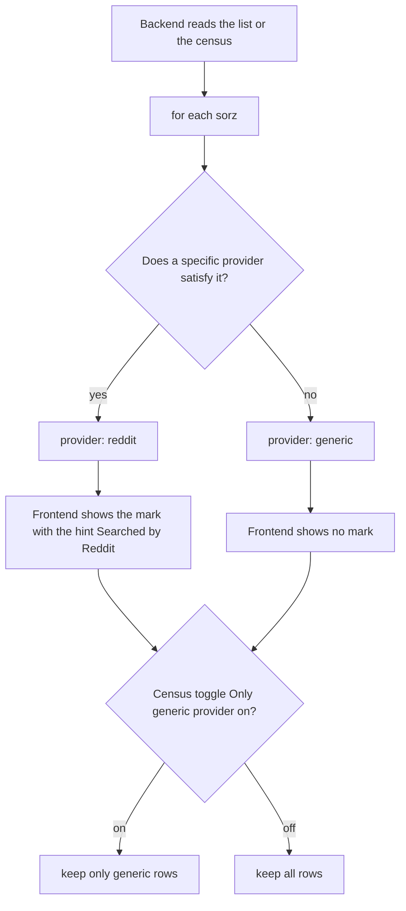

# Provider mark

Repos: `backend/`, `frontend/`, `cli/` (contract copy only), `e2e/`. Docs: `.claude/docs/search.md`, `.claude/docs/sorz-list.md`, `.claude/docs/backoffice.md`, `.claude/docs/reddit-search.md`. Decisions: `a-sorz-has-a-specific-provider-or-the-generic-one`, `search-providers-qualify-per-sorz-and-generic-is-the-catch-all`.

Goal: the sorz list and the census mark each sorz that has a specific provider, and the census can show only the sorzs with the generic provider.

A step is done when its repo's tests, lint and build pass (frontend: also typecheck and `generate:check`); then mark it `- [x]`. Work test-first. Agree the seam once, then run every cycle of a step in one go. A structural step changes no behavior. A step marked "by hand" is marked only after Xavier confirms it.

## Contract

- `provider` is the schema `SearchProviderId`: `reddit` or `generic`.
- Sorz entry (the reply of `POST /sorzs.add` and each entry of `POST /sorzs.list`): gains `provider`. The add reply needs it because the new entry shows in the side bar at once.
- `POST /sorzs.census`: each sorz of the reply gains `provider`.
- `provider` is never null: `generic` is the absent case.

## Steps

- [x] 1. Docs, by hand: Xavier reads the "Search", list and census rules in the three docs and the decision. Marked only after Xavier confirms.
- [x] 2. Backend, structural: rename `GoogleSearchProvider` to `GenericSearchProvider`, its tests, test titles and imports. The folder `infrastructure/google/` stays. Search the old name across `src/`, `test/` and `.claude/` and fix every reference, including the decision title and its index line. Remove what the move leaves empty.
- [x] 3. Contract: add `provider` to the sorz entry and the census sorz in `backend/openapi.yaml`; copy it to `frontend/` and `cli/`; run `generate` in each. Done when only the backend correspondence test fails and `generate:check` passes in both copies.
- [x] 4. Backend, test-first: `SearchProviders` names the provider that searches an entry; the add, list and census operations put it in the reply. Cases: a reddit sorz gives `reddit`, another gives `generic`, in all three replies.
- [x] 5. Frontend, list, test-first: an entry with provider `reddit` shows the mark over its favicon with the hint "Searched by Reddit", also with the side bar collapsed; `generic` shows none. The text for each identifier lives in one place.
- [x] 6. Frontend, census, test-first: the same mark and hint on each row; the toggle "Only generic provider", off at first, shows only `generic` rows in the same order; with none, an empty list and no text; reload turns it off.
- [x] 7. E2E: one scenario. Add a Reddit sorz and another; the list marks only the Reddit one. As admin, the census marks that same one, and with the toggle on only the other remains.

## Out of scope

A filter in the user's list, an icon per provider, any change in the CLI's output, showing a provider's name beyond the hint.

## Diagram

