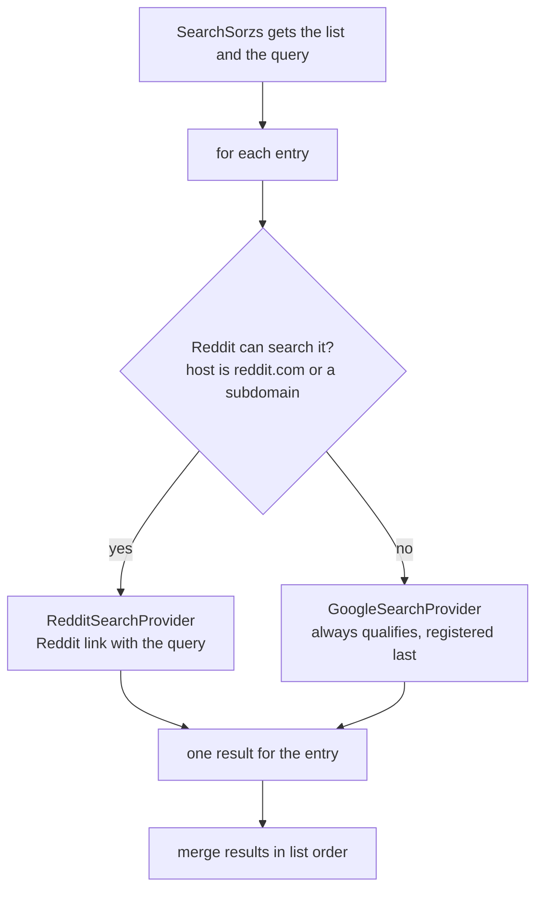

# Search providers

Repos: `backend/` only. Docs: `.claude/docs/search.md`, `.claude/docs/reddit-search.md`. Decisions: area "Search" in `.claude/decisions.md`, especially `search-providers-qualify-per-sorz-and-generic-is-the-catch-all`, `the-backend-searches-as-a-stepping-stone`, `the-stand-in-result-is-a-google-search-limited-to-the-site`.

Goal: each sorz is searched by the first provider that can satisfy it. Google qualifies for every sorz and goes last. A Reddit provider qualifies for sorzs on `reddit.com` and answers with a Reddit search link built from the query. The contract, frontend, CLI and e2e do not change: a sorz still gives one result of the same shape.

A step is done when the backend's tests, lint, typecheck and build pass; then mark it `- [x]`. Work test-first. Agree the seam once, then run every cycle of a step in one go. A structural step changes no behavior.

## Rules

- A `SearchProvider` answers two questions about a sorz entry: can it satisfy it (`canSearch`), and what is its result for a query (`search`).
- `SearchProviders` holds the specialist providers in order plus a catch-all, and searches each entry with the first specialist that can satisfy it, else with the catch-all. `GoogleSearchProvider` is the catch-all and satisfies every entry, so a provider is always found.
- `RedditSearchProvider` satisfies an entry whose address host is `reddit.com` or ends in `.reddit.com`; the path does not count. The provider asks a `QualificationStrategy` it receives; `DomainQualificationStrategy` is the one for a domain and its subdomains. Other providers may qualify by other strategies, so the domain classes (`Sorz`, `SorzEntry`) get no domain method.
- Reddit result: title "Search it on Reddit", description "Reddit search for «query»", link `https://www.reddit.com/search/?q=<query>`. Spaces in the query become `+`, every other character is URL-encoded (`café & té` gives `caf%C3%A9+%26+t%C3%A9`). The link is not restricted to the sorz's path.
- `sorz` in each result stays the name the list shows. Google's behavior is unchanged.

## Target layout

```
backend/src/
  domain/search/        SearchProvider (interface); SearchProviders; QualificationStrategy (interface); DomainQualificationStrategy
  infrastructure/
    google/             GoogleSearchProvider
    reddit/             RedditSearchProvider
  operations/sorzs/     SearchSorzs.ts (asks SearchProviders per entry)
```

## Steps

- [x] 1. Structural rename, no behavior change: `SorzSearch` to `SearchProvider`, `GoogleLinkSearch` to `GoogleSearchProvider`, `FakeSorzSearch` to its provider name; files, tests, test titles, imports. Search the old names across `src/` and `test/` and remove what the move leaves empty.
- [x] 2. Providers registry, test-first: `SearchProvider` gains `canSearch(entry)`; `GoogleSearchProvider` answers true for any entry; `SearchProviders` searches with the first qualifying specialist, else the catch-all; `SearchSorzs` takes `SearchProviders` and searches each entry through it, still in parallel and in list order. Fake providers cover "first qualifying wins" and "falls to the last".
- [x] 3. Reddit provider, test-first: `DomainQualificationStrategy` qualifies `reddit.com`, `www.reddit.com`, `old.reddit.com`, a port, not `notreddit.com`, `reddit.com.evil.org` or a domain only in the path; `RedditSearchProvider` receives it and qualifies by its answer and builds title, description and encoded link, spaces as `+`.
- [x] 4. Wiring: `SearchProvidersFactory` builds `SearchProviders` with Reddit (given its domain strategy) as specialist and Google as catch-all; `OperationRegistry` uses it. A test through `SearchSorzs` with a real `SearchProviders` shows a reddit sorz gets the Reddit result and another sorz gets the Google one.
- [x] 5. Docs, by hand: Xavier reads `search.md` and the decision after the changes; marked only after Xavier confirms.

## Out of scope

Providers for other sites, a provider that reads real results, restricting the Reddit search to the sorz's subreddit, any change to the contract or the frontend.

## Diagram


