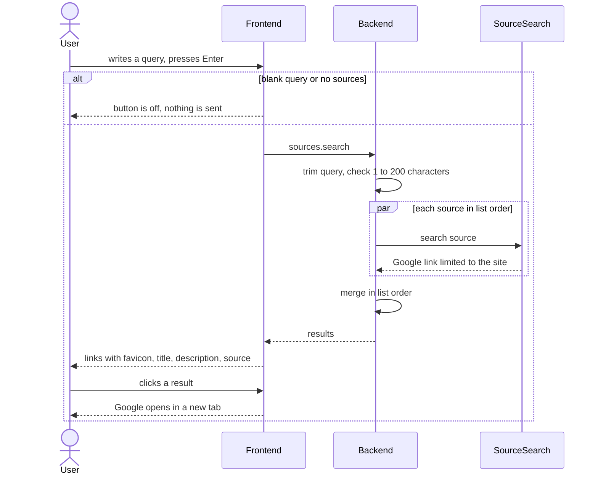

# Search sources

Repos: `backend/`, `frontend/`, `e2e/`. Docs: `.claude/docs/search.md`, `.claude/docs/source-list.md`. Decisions: area "Search" in `.claude/decisions.md`, plus `operations-validate-inside-execute`, `the-page-reader-is-an-interface-the-domain-owns`, `sources-provider-owns-the-reading-dialog-reports-onadded`, `stale-inspect-replies-are-discarded`, `the-api-reaches-components-through-one-apiprovider`, `api-wrappers-throw-refusals-and-let-network-failures-through`.

Goal: a search box in the header. The backend runs one search per source in the user's list, merges the results in list order and replies; the frontend shows them. Every search is a stand-in: a Google link limited to the source's site.

A step is done when its repo's tests, lint and build pass (frontend: also typecheck and `generate:check`); then mark it `- [x]`. Work test-first. Agree the seam once, then run every cycle of a step in one go. A step marked "by hand" is marked only after Xavier confirms it.

## Rules

- The query is trimmed; empty or over 200 characters is `INVALID_BODY`. No sources gives an empty `results`.
- One result per source, in list order: `title` "Search it on Google", `url` `https://www.google.com/search?q=<encoded query> site:<host><path>` (source address without scheme or final slash, path kept), `description` "Google search for «query» limited to site", `source` the name the list shows for it (name, else title, else address).
- Each source is searched by a `SourceSearch` the domain owns; `GoogleLinkSearch` is its stand-in. The operation calls it once per source, in parallel; a `SearchResults` merges the answers in list order.
- Frontend: a form in the header; Enter or "Search" submits. The button is off with a blank query or an empty list. The query stays; results stay until the next search, even if the list changes.
- Results fill the main area as links that open in a new tab with `noopener noreferrer`. Each shows the source's favicon, title, description and source name.
- A visible "searching" state and a visible error (`messageOf`). The answer of a superseded search is discarded.
- No "nothing found" screen.

## Contract

- `POST /sources.search`: body `{ query }` (string); reply body `{ results }`, a list of `title`, `url`, `description`, `source` (all strings). Error: `INVALID_BODY`.

## Target layout

```
backend/src/
  domain/search/        SourceSearch (interface); SearchQuery; SearchResults; SearchResult
  infrastructure/       GoogleLinkSearch
  operations/sources/   SearchSources.ts
frontend/src/
  api/                  SearchSources.ts
  domain/               SearchResult
  components/search/    SearchProvider.tsx; SearchBox.tsx; SearchResultList.tsx
  components/header/    Header.tsx holds SearchBox
e2e/
  tests/                search.spec.ts
```

## Steps

- [x] 1. Contract (backend, then frontend): add `sources.search` to `openapi.yaml`; copy it to `frontend/`, run `generate`; add the route to the `dev.ts` proxy. Ends with the backend correspondence test red only for the new route, and the frontend green.
- [x] 2. Backend domain, test-first: `SearchQuery` trims and refuses empty or over 200 with `INVALID_BODY`; `SourceEntry` gives its display name (name, else title, else address); `GoogleLinkSearch` builds the title, description and encoded link for a source and a query, path kept, scheme, final slash, question and fragment dropped; `SearchResults` merges answers in the order given.
- [x] 3. Backend operation, test-first, with a fake `SourceSearch`: `SearchSources` builds the `SearchQuery` from the body, searches every source of the list in parallel, replies in list order with the source's display name; an empty list gives empty `results`. Registered in the registry; the correspondence test turns green.
- [x] 4. Frontend API, test-first: `SearchSources` wraps the generated client, throws refusals and lets network failures through; `SearchResult` exposes its parts.
- [x] 5. Frontend state, test-first: `SearchProvider` keeps query, state and results; discards the answer of a superseded search; keeps results when the list changes.
- [x] 6. Frontend box and results, test-first: `SearchBox` submits on Enter and button, is off with a blank query or empty list, keeps the query; `SearchResultList` shows favicon, title, description and source, links open in a new tab with `noopener noreferrer`; searching and error states show.
- [x] 7. Look and flow, by hand: Xavier adds two sources (one with a path), searches, follows a link, searches again while one is running, searches with no sources.
- [x] 8. E2E (`e2e/`): with a source added, a test writes a query, searches and sees a result whose link is the expected Google address.

## Out of scope

Real results, ranking, a "nothing found" screen, history, searching a subset of sources, suggestions while typing, deciding the fate of this operation when the frontend module arrives.

## Diagram


