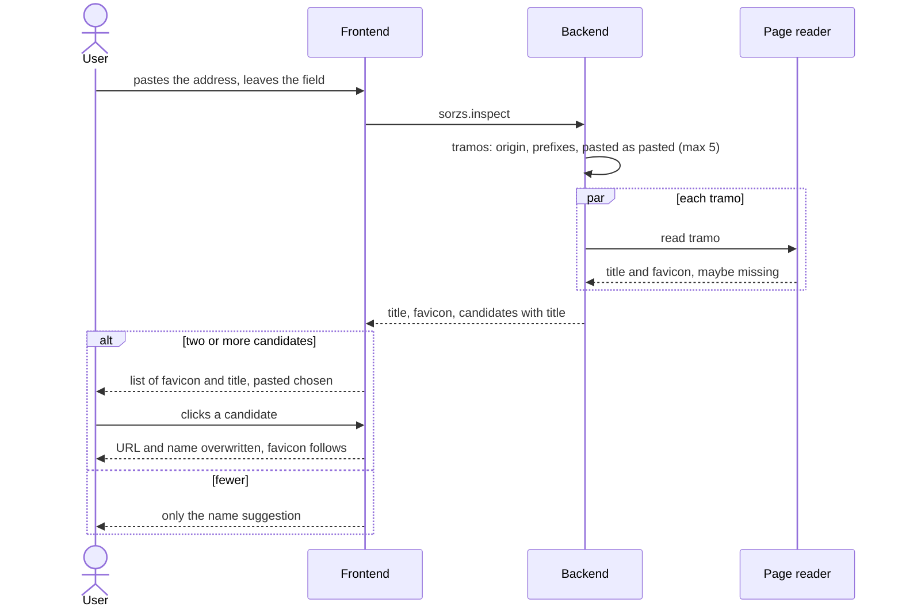

# Sorz path candidates

Repos: `backend/`, `frontend/`, `e2e/`. Docs: `.claude/docs/sorz.md`, `.claude/docs/sorz-list.md`. Decisions: areas "Sorzs, domain", "Sorzs, page reading and candidates" and "Add dialog and list" in `.claude/decisions.md`, plus `operations-validate-inside-execute`, `the-page-reader-is-an-interface-the-domain-owns`, `sorzs-provider-owns-the-reading-dialog-reports-onadded`.

Goal: a site often holds several sorzs, so the add dialog offers every tramo of the address the user pasted, each with its title. Clicking one makes its address the URL and its title the name.

A step is done when its repo's tests, lint and build pass (frontend: also typecheck and `generate:check`); then mark it `- [x]`. Work test-first. Agree the seam once, then run every cycle of a step in one go. A step marked "by hand" is marked only after Xavier confirms it.

## Rules

- Candidates of `https://www.talk.com/dfe/dert/deftgh.html`: `https://www.talk.com`, `https://www.talk.com/dfe`, `https://www.talk.com/dfe/dert`, and the last one exactly as pasted (trimmed of spaces; query, fragment and final slash kept).
- Derived candidates carry no query, fragment or final slash. A derived one that differs from the pasted only by the final slash is dropped.
- At most 5 candidates: the origin and the 4 deepest. All are read in parallel with the limits of `HttpPageReader`.
- Only candidates with a title are offered. The reply lists them from the root to the pasted address.
- The dialog shows the list only with two or more candidates. Each shows favicon and title, the address on hover; the one holding the dialog's address and name is marked chosen. Titles repeated are all shown.
- Clicking a candidate overwrites URL and name, even a name the user wrote; the list stays, the favicon beside the name follows the chosen one.
- A reply for an address the user has since changed is discarded. No spinner; a failure is silent.
- Registering is unchanged: title and favicon are learned from the registered address.

## Contract

- `POST /sorzs.inspect`: the reply body keeps `title` and `favicon` of the pasted address and gains `candidates`, a list of `address` (string), `title` (string), `favicon` (string or null). The list may be empty. Error: `INVALID_BODY`, as now.

## Target layout

```
backend/src/
  domain/sorz/        CandidateAddresses (the tramos of an address, capped); PageInfo unchanged
  operations/sorzs/   InspectSorz.ts reads the candidates in parallel
frontend/src/
  api/                  InspectSorz.ts returns candidates
  domain/               AddressCandidate
  components/sorzs/   AddSorzDialog.tsx; CandidateList.tsx
e2e/
  sample-site/          a page with a title at each tramo of a path; tests/add-sorz.spec.ts picks one
```

## Steps

- [x] 1. Contract (backend, then frontend): add `candidates` to the `sorzs.inspect` reply in `openapi.yaml`; copy it to `frontend/`, run `generate`. Ends with the backend correspondence test green if the operation is untouched, otherwise red only for that reply, and the frontend green.
- [x] 2. Backend domain, test-first: `CandidateAddresses` builds the tramos of a `SorzAddress` (origin, each prefix, the pasted as pasted), drops the derived twin of the pasted, keeps the origin and the 4 deepest.
- [x] 3. Backend operation, test-first, with a fake reader: `InspectSorz` reads every candidate, replies only those with a title, in order, still with `title` and `favicon` of the pasted address; `INVALID_BODY` unchanged. Then check against `HttpPageReader` that parallel reads respect each one's limits.
- [x] 4. Frontend API and entry, test-first: `InspectSorz` returns `AddressCandidate` objects; `AddressCandidate` exposes its address, title and favicon.
- [x] 5. Frontend dialog, test-first: `CandidateList` shows with two or more candidates, marks the chosen one, shows the address on hover; a click overwrites URL and name and moves the favicon; a stale reply is dropped; a failure is silent. The name suggestion of step 7 of `sorz-title-and-favicon.md` keeps working.
- [x] 6. Look and flow, by hand: Xavier pastes a deep address of a real site, picks tramos, adds one; also a bare origin (no list) and a path where an intermediate tramo gives 404.
- [x] 7. E2E (`e2e/`): the sample site serves a path whose tramos have titles; a test pastes the deepest address, sees the list, clicks the origin, adds it and sees its title in the side bar.

## Out of scope

Collapsing repeated titles, refreshing, caching the reply, choosing which tramos to read, a spinner, protection against addresses that point to the host's own network.

## Diagram


