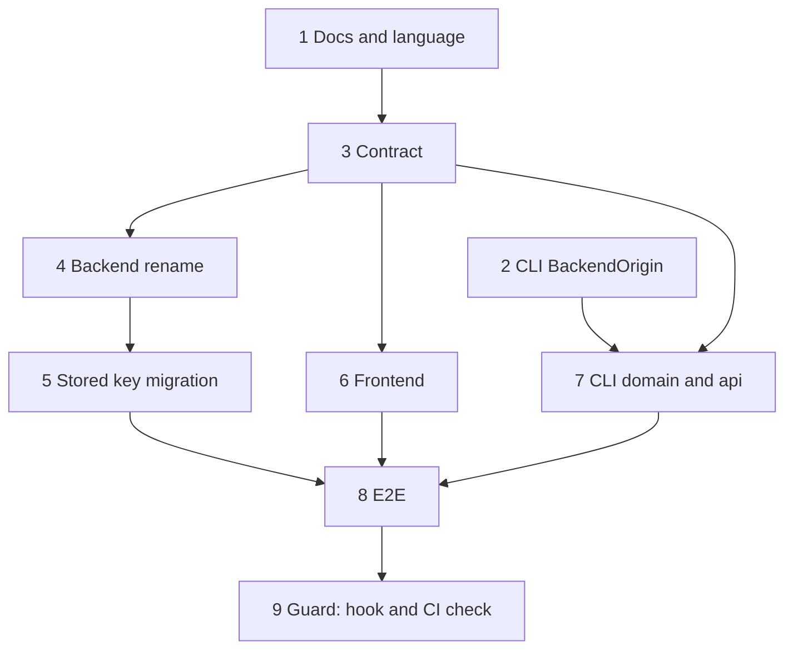

# Sorz vocabulary

Repos: `backend/`, `frontend/`, `cli/`, `e2e/`. Docs: `.claude/docs/sorz.md`, `.claude/docs/sorz-list.md`, `backoffice.md`, `cli.md`, `search.md`. Decisions: `the-domain-says-sorz-and-the-word-source-names-nothing`, `sorz-and-list-entry-are-separate-concepts`, `the-sorzs-section-reads-a-sorz-census`, `each-result-names-its-sorz-as-the-list-does`, `sorzs-persist-in-sqlite-as-json-documents`.

Goal: the word "source" names nothing in Sorzs. The shared single address is a sorz; the user's list holds sorz entries; the admin's count is the census.

A step is done when its repo's tests, lint, typecheck and build pass; then mark it `- [x]`. Steps 2 to 4, 6 to 8 are structural: rename and move only, no behavior change. Step 5 is behavioral and test-first. Run the repo's tests after every move or rename; after moving a folder, list the old location and remove what is left empty.

## Rules

- Vocabulary: `Sorz`, `SorzId`, `SorzAddress`, `SorzList`, `SorzEntry`, `SorzName`, `SorzCensus`, `CensusEntry`. Folders `domain/sorz/`, `domain/sorz-list/`.
- Contract: operations `sorzs.add`, `sorzs.inspect`, `sorzs.list`, `sorzs.search`; the admin census, today `sorzs.sources`, becomes `sorzs.census`. Schemas follow (`SorzEntry`, `SorzsAddCall`, ...); `sourceId` becomes `sorzId`. Error codes `SOURCE_ALREADY_REGISTERED` and `SOURCE_NAME_TAKEN` become `SORZ_...`.
- Backend: `operations/sources/` and `operations/sorzs/` join in `operations/sorzs/`; `ListSorzsSources` becomes `Census`. The search result field `source` becomes `sorz`.
- Stored entries: the JSON key `sourceId` is read as `sorzId`; saved documents are rewritten when the service starts.
- Frontend: `components/sources/` becomes `components/sorzs/`; the backoffice census classes become `Census*`; `api/sources/` and `api/sorzs/` join in `api/sorzs/`; every visible text says sorzs.
- CLI: `domain/source/` and `api/source/` become `sorz`; commands and help say sorz; `BackendSource` becomes `BackendOrigin`.
- Guard: a hook with its test in `.claude/hooks/` warns when an edit under `src/` or `test/` of any repo brings `source` in; a one-line check in each repo's CI fails on the same word. Both read one list of exceptions, empty at the start; each exception carries its reason.

## Steps

- [x] 1. Docs and language: rename `docs/source.md` and `docs/source-list.md` to `sorz.md` and `sorz-list.md`; say sorz in every doc and in the project `CLAUDE.md`; add its Language section; fix the doc names that decisions and specs point to. Done when Xavier approves them.

The decisions and the finished specs keep the names of the code they describe, and each is corrected, renamed and re-indexed in the step that renames that code (steps 3 to 8).
- [x] 2. CLI, `BackendSource` to `BackendOrigin`. Done when the CLI passes tests, lint and build.
- [x] 3. Contract: rename routes, schemas, codes in `backend/openapi.yaml`; copy to `frontend/` and `cli/`, regenerate each client, update the `dev.ts` proxy. Done when only the backend correspondence test is red and `frontend/` passes `generate:check`, lint, typecheck, test and build.
- [x] 4. Backend, structural: folders, classes, operations, registry, tests, the result field. Done when the correspondence test is green.
- [x] 5. Backend, behavior, test-first: a document saved with `sourceId` is read as `sorzId`, and rewritten at start. Tried on a copy of `data/sorzs.db`.
- [x] 6. Frontend: folders, classes, api, texts. Done when `generate:check`, lint, typecheck, test and build pass.
- [x] 7. CLI, dominio and api, commands, help and their tests.
- [x] 8. E2E: rename the specs and adjust selectors to the new texts. Done when the whole suite passes.
- [x] 9. Guard: the hook with its test, the CI check in the four repos, the exceptions list. Done when each repo's CI is green with an empty list or with reasoned exceptions only.

## Out of scope

Changing any rule of a sorz or its list; renaming the product; renaming `users`, `session` or `backoffice` concepts.

## Diagram

