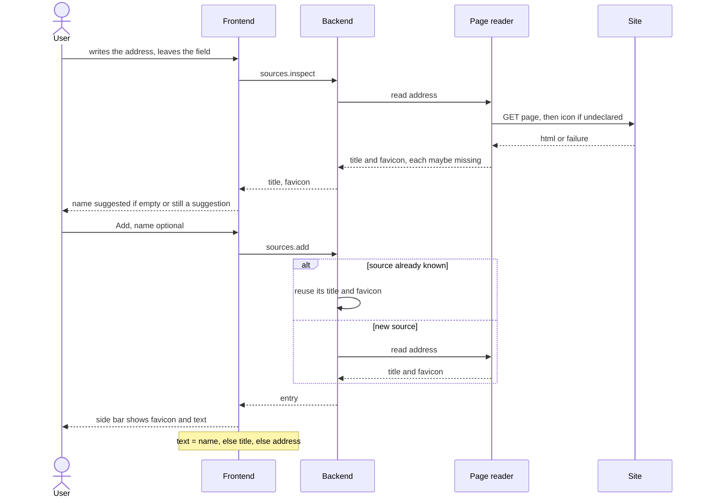

# Source title and favicon

Repos: `backend/`, `frontend/`, `e2e/`. Docs: `.claude/docs/source.md`, `.claude/docs/source-list.md`. Decisions: area Sources in `.claude/decisions.md`, plus `operations-validate-inside-execute`, `errors-carry-their-contract-code`, `domain-has-its-own-folder-one-per-concept`, `side-bar-owns-the-reading-dialog-reports-onadded`.

Goal: the side bar shows each source as its favicon, then the user's name, or the page's title when there is no name, or the address when there is neither. The add dialog suggests the page's title as the name once the address is written.

A step is done when its repo's tests, lint and build pass (frontend: also typecheck and `generate:check`); then mark it `- [x]`. Work test-first. Agree the seam once, then run every cycle of a step in one go. A step marked "by hand" is marked only after Xavier confirms it.

## Contract

- `POST /sources.inspect`: body `address`. Reply body: `title`, `favicon`, each a string or null. Error: `INVALID_BODY`. Nothing is registered.
- `POST /sources.add`: `name` becomes optional (empty after trimming means none). The reply entry gains `title` and `favicon` (string or null), and `name` may be null.
- `POST /sources.list`: its entries carry the same fields.

## Target layout

```
backend/src/
  domain/
    source/             Source gains title and favicon; PageReader, PageInfo, PageTitle, FaviconAddress
    source-list/        SourceEntry name optional
  infrastructure/
    HttpPageReader.ts
  operations/sources/   InspectSource.ts; AddSource.ts, ListSources.ts adjusted
frontend/src/
  api/                  InspectSource.ts
  domain/               SourceEntry gains title, favicon and the text it is shown by
  components/sources/   AddSourceDialog.tsx, SourceSideBar.tsx adjusted
e2e/
  docker-compose + sample page server; tests/add-source.spec.ts adjusted
```

## Steps

- [x] 1. Contract (backend, then frontend): add `sources.inspect`, make `name` optional and add `title` and `favicon` to the entry in `openapi.yaml`; copy it to `frontend/`, run `generate`, add the route to the `dev.ts` proxy. Ends with the backend correspondence test red only for the new route and the frontend green. Done with the entry's `name` nullable in the frontend's `SourceEntry`, and the side bar showing the address when there is no name; step 5 adds `title`, `favicon` and the title fallback.
- [x] 2. Backend domain, test-first: `SourceName` allows none (empty after trim); `SourceList` lets entries without a name coexist and still refuses a repeated name ignoring case. `Source` holds title and favicon, each possibly missing. `PageTitle` trims and bounds the title; `FaviconAddress` keeps only `http://` and `https://`. The `PageReader` interface returns `PageInfo` and never throws.
- [x] 3. Backend operations, test-first, with a fake reader: `InspectSource` (ok, missing parts, `INVALID_BODY`); `AddSource` without a name, reading title and favicon at each registration (a repeated address is refused as now); `ListSources` returns the new fields. Back green, correspondence test green.
- [x] 4. Backend `HttpPageReader`, test-first against a local server started in the test: title, declared icon, `/favicon.ico` fallback, relative icon addresses resolved against the page, non-http icon dropped, timeout, 1 MB cap, 3 redirects, non-HTML ignored. Wire it in place of `BlankPageReader` (a stand-in step 3 registers in `OperationRegistry.standard`), then delete `BlankPageReader`. A runtime dependency, if any, also goes into the `Dockerfile`.
- [x] 5. Frontend API and entry, test-first: `InspectSource` wraps the generated client; `SourceEntry` exposes the text it is shown by (name, else title, else address) and its favicon.
- [x] 6. Frontend side bar, test-first: each entry shows the favicon on the left of the text, a neutral icon when there is none, the address as `title` on hover.
- [ ] 7. Frontend dialog, test-first: leaving the address field calls `InspectSource`; the title fills the name only when the field is empty or still holds an earlier suggestion; a title is never suggested when the page offers none; an inspect failure is silent. Submitting with an empty name is allowed.
- [ ] 8. Look and flow, by hand: Xavier adds sources with and without a name against the real backend, with a site that has a title and icon and one that does not.
- [ ] 9. E2E (`e2e/`): serve the sample page from the compose; the happy-path test adds it with no name and sees its title and icon in the side bar.

## Out of scope

Refreshing title or favicon, renaming, caching the inspect reply, protection against addresses that point to the host's own network, previews.

## Diagram


