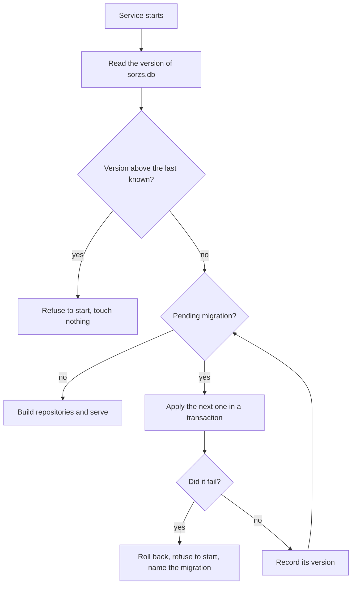

# SQLite migrations

Repo: `backend/`. Docs: `.claude/docs/migrations.md`, `.claude/docs/user.md`, `.claude/docs/sorz-list.md`. Decisions: `migrations-are-numbered-steps-written-by-hand`, `sorzs-persist-in-sqlite-as-json-documents`, `users-persist-in-sqlite-and-the-seed-only-adds-the-missing`.

Goal: the schema of `sorzs.db` changes through numbered migrations that run once at start, before the repositories open, instead of functions inside the repositories.

A step is done when the backend's tests, lint, typecheck and build pass; then mark it `- [x]`. Work test-first. Agree the seam once, then run every cycle of a step in one go. A structural step changes no behavior. A step marked "by hand" is marked only after Xavier confirms it.

## Design

`backend/src/infrastructure/sqlite/migrations/`, one class per file:

- `Migration`: the interface; it applies itself to a database.
- `Migrations`: the ordered list and the runner.
- `CreateEntriesTable`, `AddOwnerToEntries`, `RenameOldIdentifierKey`, `CreateUsersTable`: versions 1 to 4, each tolerant of a state already applied.
- `MigrationFailedError` and `NewerDatabaseError`, each in its own file, in the same folder.
- `MigratedDatabaseFactory` and `UnreadableDatabaseError` in `sqlite/`: the factory opens the file (or memory), refuses a file that cannot be read and runs `Migrations`.

`Server.start` asks the factory for the connection and hands it to `OperationRegistry` and `AuthSettings`, which build the repositories on it. `SqliteUsers` keeps the seed. The two per-repository unreadable errors become the single `UnreadableDatabaseError`.

## Steps

- [x] 1. `Migration` and `Migrations`, test-first, with fake migrations on a temporary database: applies only the pending ones in order and records the version; a failing one rolls back, keeps the earlier version and raises `MigrationFailedError` naming the migration; a database above the last known version raises `NewerDatabaseError` and is left untouched; a database at the last version changes nothing.
- [x] 2. The four real migrations, test-first, each starting from the previous state of the database: creates the table; adds `owner` giving earlier rows to `xaviuzz`, and does nothing when the column exists; rewrites `sourceId` to `sorzId` and leaves documents that already say `sorzId`; creates `users`, and does nothing when it exists. A database at version 0 with some or all of those effects lands on version 4 with its rows intact.
- [x] 3. Structural: `Server.start` runs `Migrations` first; `SqliteSorzListRepository` and `SqliteUsers` stop creating tables and migrating (`SqliteUsers` keeps the seed); the repository tests build their database through the factory. Tests that start a server or the registry keep passing a temporary folder. A file that cannot be read still stops the start.
- [x] 4. Structural: `language-exceptions.txt` lists `RenameOldIdentifierKey.ts` and the tests that write `sourceId`, no longer the repository; update the "Image" and "Layout" paragraphs of `backend/CLAUDE.md` (the rows given to `xaviuzz` come from migration 2; point to `migrations.md`). Search `.claude/` for references to the old place and fix them.
- [x] 5. By hand: copy the current `backend/data/sorzs.db`, start the backend on the copy and check it lands on version 4 with the list and the users intact; start it again and check nothing changes; start the previous build on it and check it refuses a newer version only if a later migration exists, otherwise skip that check. Marked only after Xavier confirms.

## Out of scope

Going back, a command to run migrations apart from the start, status or dry run, automatic copy before updating, a library.

## Diagram

