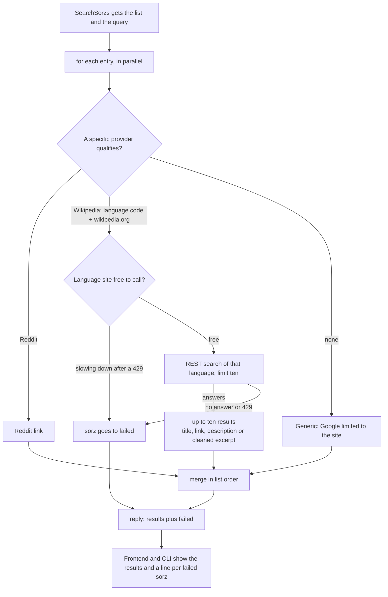

# Wikipedia provider

Repos: `backend/`, `frontend/`, `cli/`, `e2e/` (configuration only). Docs: `.claude/docs/wikipedia-search.md`, `.claude/docs/search.md`, `.claude/docs/sorz-list.md`, `.claude/docs/backoffice.md`. Decisions: `wikipedia-search-reads-the-rest-search-and-takes-its-language-from-the-address`, `search-providers-qualify-per-sorz-and-generic-is-the-catch-all`, `a-sorz-has-a-specific-provider-or-the-generic-one`, `e2e-covers-the-happy-path-only`. Findings: `.claude/reference/wikipedia-api.md`.

Goal: a sorz on a language Wikipedia is searched by a Wikipedia provider that returns up to ten real results, each with title, link and description. It is the first provider that returns several results per sorz and the first that can fail.

A step is done when its repo's tests, lint and build pass (frontend and CLI: also typecheck and `generate:check`); then mark it `- [x]`. Work test-first. Agree the seam once, then run every cycle of a step in one go. A structural step changes no behavior. A step marked "by hand" is marked only after Xavier confirms it. A tidy step is structural and eases the step it names; it runs before it.

## Rules

The rules are in `.claude/docs/wikipedia-search.md`; this spec adds none.

## Decisions

Settled with Xavier before the steps; step 2 records each as its own decision file.

1. A Wikipedia sorz shows the mark with the hint "Searched by Wikipedia" in the list and the census. `SearchProviderId` gains `wikipedia`; shown as `generic` it would be a lie and the census toggle "Only generic provider" would list it.
2. `SorzsSearchBody` gains `failed`, the names of the sorzs that did not answer, next to `results`. It is required. The reply stays a 200.
3. The contact for the User-Agent is a required variable `WIKIPEDIA_CONTACT`, like `AUTH_SECRET`; the server refuses to start without it, and the User-Agent reads `Sorzs (<contact>)`.
4. On a 429 the sorz fails, and the provider makes no call to that language site until the `Retry-After` seconds pass (60 when absent); memory only. Another language is unaffected.
5. No e2e scenario: a real Wikipedia makes e2e depend on the network, and `e2e-covers-the-happy-path-only` asks for a reason the backend and frontend tests cannot give. Step 19 only gives the e2e backend its contact variable.
6. Each call to Wikipedia is cut at 3 seconds, as in `HttpPageReader`; a cut counts as no answer.
7. The frontend and the CLI show one line per sorz in `failed`, after all the results.
8. The line reads «<name> did not answer», in English like the other screen texts, with no cause.

## Steps

Numbered by dependency. A tidy step shows beside it the step it eases.

- [x] 1. Change surface analysis, no code, confirmed by Xavier. Its result is the steps below: seven tidies, and these findings the steps already carry. The correspondence test compares route names only, so a schema change leaves it green. `SorzEntry` exposes no host, only `site()`. The contact needs a settings class of its own. Nothing verifies the backend against the schema.
- [x] 2. Docs and decisions, by hand: update `search.md`, `sorz-list.md`, `backoffice.md` and `wikipedia-search.md` where a decision above changes a rule (the failure line after the results with its text; the 3-second cut; the doc's own open question on repeated results is already answered by the rule that two sorzs are searched separately). Define the language code in `wikipedia-search.md`: one label of lowercase letters and hyphens, never `www`; Xavier changes it here if wrong. Record one decision per item above in `.claude/decisions/` with its line in the index, and check whether `search-providers-qualify-per-sorz-and-generic-is-the-catch-all` and `a-sorz-has-a-specific-provider-or-the-generic-one` are now obsolete (they describe Reddit as the only specialist and a provider returning one result). Xavier reads the docs and the decisions. Marked only after Xavier confirms.
- [x] 3. Backend, structural: `SearchProvider.search` returns `SearchResults` instead of one `SearchResult`. `SearchResults` gains a way to add another `SearchResults`. `GenericSearchProvider`, `RedditSearchProvider`, `SearchProviders`, `StubSearchProvider`, `FakeSearchProvider` and `SearchSorzs` follow; `SearchSorzs` merges the answers in list order. The test helpers of Generic, Reddit and `SearchProviders` choose once what they return. Tests stay green with the same reply.
- [x] 4. Tidy C, backend, eases step 5: one named type for the provider id replaces `"reddit" | "generic"` in `ProviderId.ts` and `SorzCensus.ts`. Done when `typecheck` passes.
- [x] 5. Contract: in `backend/openapi.yaml`, add `wikipedia` to `SearchProviderId` and `failed` to `SorzsSearchBody` (decisions 1 and 2); copy it to `frontend/` and `cli/`; run `generate` in each. Done when `generate:check`, typecheck, lint, tests and build pass in `frontend/` and `cli/`, and the backend passes all of its own. The correspondence test compares route names only, so it stays green. Until step 11 the backend does not send `failed`; nothing reads it before steps 17 and 18. No new route, so the frontend's `dev.ts` proxy stays.
- [x] 6. Tidy A, backend, eases step 8: `SorzEntry` gains `hostname()` (through `WebAddress`, `SorzAddress` and `Sorz`), and `DomainQualificationStrategy` reads it instead of re-parsing `site()`. Done when `DomainQualificationStrategy.test.ts` passes unchanged.
- [x] 7. Tidy B, backend, eases steps 8 and 9: one test helper builds a `SorzEntry` from an address, and the five search tests that repeat that construction use it (`DomainQualificationStrategy`, `SearchProviders`, Reddit, Generic twice). Done when those tests pass with their assertions unchanged.
- [ ] 8. Backend, qualification, test-first: a `WikipediaQualificationStrategy` qualifies `es.wikipedia.org`, `en.m.wikipedia.org`, any path and a port; refuses `wikipedia.org`, `www.wikipedia.org`, `notwikipedia.org`, `es.wikipedia.org.evil.org` and `wikipedia.org` only in the path. The language (`es`) is read from `SorzEntry.hostname()` by one value object, never from anywhere else, and follows the language code defined in step 2. `DomainQualificationStrategy` stays as it is.
- [ ] 9. Backend, results, test-first: `WikipediaSearchProvider` asks the REST search of the language site for the query with a limit of ten, through a `fetch` it receives so tests fake Wikipedia; the call is cut at 3 seconds. Cycles: the request goes to the sorz's language and carries the User-Agent; one result per page with title and description; the link is `https://<lang>.wikipedia.org/wiki/<key>` with special characters encoded except `_`, `(` and `)`; a missing description falls back to the excerpt without tags and with entities decoded (the `he` library already in the backend; no new dependency); no pages gives no results; each result carries the sorz as the list shows it; two sorzs of one Wikipedia are asked separately.
- [ ] 10. Tidy D, backend, eases steps 11 and 16: the SUT of `SearchSorzs.test.ts` builds `new SearchProviders([], this.searching)` three times; it holds one in a field. Done when the file passes unchanged.
- [ ] 11. Backend, failure, test-first: when Wikipedia does not answer (network failure, non-success status, unreadable body) the provider fails and `SearchSorzs` reports that sorz in `failed`, still returning the results of the others in list order. A fake failing provider and a working one show both in one reply.
- [ ] 12. Backend, slowing down, test-first (decision 4): after a 429 the provider makes no call to that language site until `Retry-After` passes; the sorz fails meanwhile; another language is unaffected. A fake clock drives the cycles.
- [ ] 13. Tidy E, backend, eases step 16: reading a required environment variable (`require`, the `Environment` type, `MissingSettingError`, `InvalidSettingError`) leaves `AuthSettings` and the `auth/` folder for a neutral one, so a second settings class reuses it. Done when `AuthSettings.test.ts` passes unchanged.
- [ ] 14. Tidy F, backend, eases step 16: the SUT of `SearchProvidersFactory.test.ts` calls `build()` twice; it holds one `SearchProviders` in a field. Done when the file passes unchanged.
- [ ] 15. Tidy G, backend, eases step 16: `authEnvironment()` in `test/AuthEnvironment.ts` is renamed to say it feeds the whole server, since it will also carry `WIKIPEDIA_CONTACT`. Done when `typecheck` and the tests pass.
- [ ] 16. Backend, wiring, test-first: `ProviderId.wikipedia()`; `SearchProvidersFactory` registers the Wikipedia provider after Reddit and before the generic one. A `SearchSettings` class reads `WIKIPEDIA_CONTACT` with the reader of step 13, and the server refuses to start without it (decision 3); the contact travels through `main.ts`, `Server.start` and `OperationRegistry.standard`, and is documented in `backend/CLAUDE.md` with the development command. A test through `SearchSorzs` with a real `SearchProviders` shows a Wikipedia sorz gets only Wikipedia results and never the Google one; add, list and census replies name the provider `wikipedia`; check whether the Census, ListSorzs and AddSorz tests assert the provider id. The correspondence test stays green.
- [ ] 17. Frontend, test-first: `providerNamed` knows `wikipedia` with its own provider class, specific, and the hint "Searched by Wikipedia"; the census toggle needs no change because it reads `isSpecific()`. The mark shows in the list, the collapsed side bar and the census; several results of one sorz render each with its sorz's favicon and name; the sorzs in `failed` show one line each after the results, reading «<name> did not answer», and the other results still show. The reply fakes of `SearchProvider.test.tsx`, `SearchSorzs.test.ts` and `SearchBox.test.tsx` carry `failed`.
- [ ] 18. CLI, test-first: the search prints the hits of a Wikipedia sorz as for any other and, after the hits, one line per sorz in `failed` with the same text. `FakeSorzs` and the reply of `ApiSorzs.test.ts` carry `failed`.
- [ ] 19. E2E, configuration only: `compose.yaml` gives the backend a `WIKIPEDIA_CONTACT` so the server starts; the existing scenarios still pass. No Wikipedia scenario (decision 5).
- [ ] 20. Real Wikipedia, by hand: Xavier runs the app, registers `https://es.wikipedia.org` and `https://en.wikipedia.org`, searches `ciberpunk` and `cyberpunk`, follows a result, and stops the network to see the failure line. Marked only after Xavier confirms.

## Out of scope

The content of the pages, images, a next page, several languages at once, translating the term, other Wikimedia sites, signing in to Wikipedia, removing repeated results between two sorzs of one Wikipedia, an e2e scenario against real Wikipedia.

## Diagram

