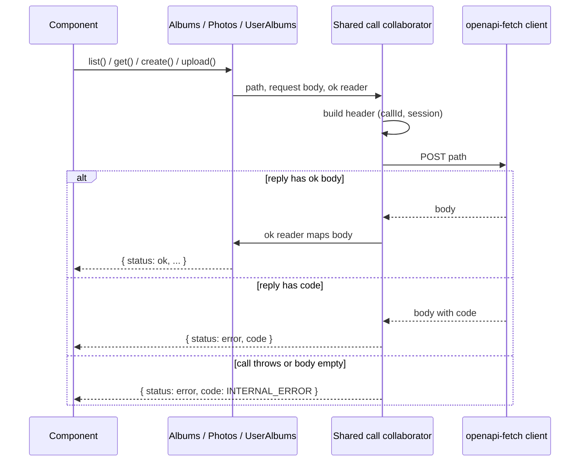

# Frontend API refactor (relaxed SOLID review)

Scope: `frontend/src/api/` (`Albums`, `Photos`, `UserAlbums`, `HealthCheck`, `Api`). Pure refactor: no behavior change, no contract change, no functional doc touched (`.claude/docs/` unaffected).

Problem: `list`, `get`, `create` and `upload` each repeat the same call mechanics (call id, session header, `try/catch`, `INTERNAL_ERROR` default, `"x" in body` / `"code" in body` branching). Each class repeats the `#client`/`#session` fields and constructor. Three error-code aliases name one type. A new endpoint is a copy of an 18-line block.

Each step keeps `bun run test`, lint, typecheck, build and `generate:check` green, and is structural only. Existing tests in `test/api/` are the safety net; add a test only for a collaborator that gains its own public behavior. Items are numbered in dependency order, impact beside each.

- [ ] 1. One `ApiErrorCode` replaces `PhotoErrorCode`, `AlbumErrorCode`, `UserAlbumErrorCode`; update every importer (src and test). Impact: medium.
- [ ] 2. One generic answer type: the error branch `{ status: "error"; code: ApiErrorCode }` is written once; `PhotosAnswer`, `UploadAnswer`, `AlbumsAnswer`, `AlbumAnswer`, `UserAlbumAnswer` keep their ok fields, so consumers do not change. Impact: medium.
- [ ] 3. Extract the call mechanics into one collaborator that owns client and session: builds the header, catches failures into `INTERNAL_ERROR`, turns a reply body into the ok or error answer. Each endpoint method passes only its path, its request body and how to read the ok body. Move `Albums` first (list maps, get maps), tests green, then `UserAlbums` (retires `answerOf`), then `Photos`, then `HealthCheck` if it fits without growing. Impact: high.
- [ ] 4. `Photos.upload`: extract the `FormData` and `bodySerializer` construction into a private method so `upload` reads like the other endpoints. Impact: low.
- [ ] 5. `Api` builds the collaborator once and passes it to each endpoint class, so none of them takes `client` and `session`. Impact: low.

## Out of scope

- Interfaces for the endpoint classes: `Api` is the composition root and tests inject `fetch`, so the seam exists (no speculative DIP).
- Moving `PresentedAlbum` mapping out of the API classes: after step 3 it is the ok-reading argument.
- `ApiContext` hooks.

## Open questions

- Exact seam of step 3 (a class wrapping `post`, or a function taking a reader)? Decide before step 3 and record it in `.claude/decisions.md` with its why.
- Does `HealthCheck` join the shared collaborator, or keep its `"ok" | "error"` result untouched?

## Diagram

