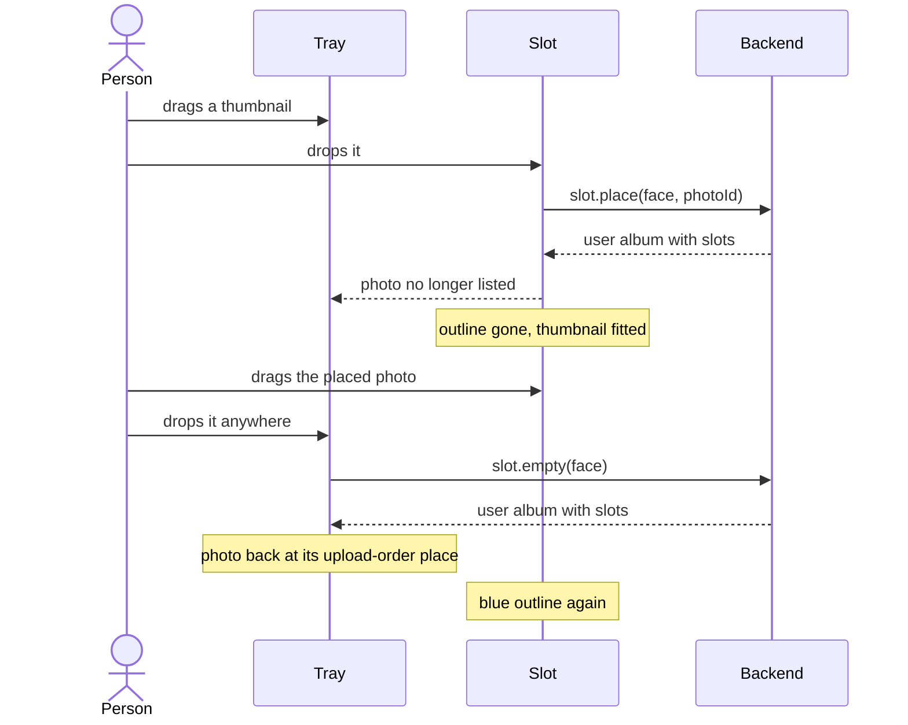

# Slots

Repos: `backend/`, `frontend/`, `e2e/`. Docs: `docs/slot.md`, `docs/photo.md`, `docs/user-album.md`. Decisions and their why: `.claude/decisions.md`, area "Slots". No Penpot work.

Goal: every face of the user album shows one slot; the person drags a photo from the tray onto it and the photo leaves the tray; dragging it back onto the tray empties the slot. The occupants survive a reload. `npm run e2e` proves it.

A step is done when its repo's tests, lint, typecheck and build pass (in `e2e/`, when `npm run e2e` is green); then mark it `- [x]`. Work test-first. Agree the seam once, then run every cycle of a step in one go. A step marked "by hand" is marked only after Xavier confirms it. No dependency is added.

## Behavior

- The user album answer (`userAlbum.create`, `userAlbum.get`) gains `slots`: one entry per face, `{ face, photoId }`, with `photoId` null when empty. Faces and slot geometry are still not sent: the frontend derives the geometry from the page size.
- `POST /slot.place` takes `callId`, `face` and `photoId`, requires `sessionId`, and answers the user album. Errors: `SESSION_REQUIRED`, `USER_ALBUM_NOT_FOUND`, `FACE_NOT_FOUND` (outside 1 to the page count), `PHOTO_NOT_FOUND` (unknown, or of another session). Placing in an occupied slot replaces the photo.
- `POST /slot.empty` takes `callId` and `face`, requires `sessionId`, and answers the user album. Same errors but `PHOTO_NOT_FOUND`. Emptying an empty slot is not an error.
- The occupants are stored with the user album in `DATA_DIR/<sessionId>/user-album.json`. A file with no occupants reads as every slot empty.
- Slot geometry: 90 % by 90 % of the page size, 5 % margin on each side, rounded inwards to the millimetre (`docs/slot.md`).
- The tray shows the photos of `photo.list` that occupy no slot, in upload order.
- The face draws its slot at 5 % from each edge and 90 % by 90 % in size. Empty, it has a thin blue outline; occupied, no outline and the thumbnail fitted inside (`object-fit: contain`), centred.
- Dragging uses the native drag and drop. A tray thumbnail dragged onto the slot calls `slot.place`; the photo of an occupied slot dragged onto the tray (anywhere in it) calls `slot.empty`. No visual change while dragging.
- A failed placement or emptying shows an `Alert` and leaves the tray and the slot as they were.

## Steps

- [x] 1. Docs: `docs/slot.md`, `docs/photo.md`, `docs/user-album.md`, and the decisions of area "Slots".
- [ ] 2. Contract (`backend/`, then `frontend/`): `/slot.place` and `/slot.empty`, `slots` in the `UserAlbum` schema, the codes `FACE_NOT_FOUND` and `PHOTO_NOT_FOUND`. Copy the file to `frontend/`, run `generate`, add both routes to the `dev.ts` proxy. The correspondence test is red until step 3; the step is done when it is the only failing test in `backend/` and `frontend/` is fully green.
- [ ] 3. Backend (`backend/`). Decisions: "Each face has one fixed slot", "Slot operations answer the user album", "A photo is in one place only". Cycles, in this order, one go:
  1. `Slot` and `FaceSlots` in `domain/`: the occupant of each face of a user album, with place, empty and replace; geometry is not part of it.
  2. `UserAlbum` carries its slots, all empty when made; `UserAlbumStore` writes and reads them, and a stored file without them reads as empty.
  3. The user album answer includes `slots`.
  4. `slot.place`, with its errors; the photo is looked up in the `PhotoStore` of the session.
  5. `slot.empty`.
  Both registered in the `Server`. Check the Dockerfile still builds.
- [ ] 4. Frontend, API (`frontend/`). Decision: "Slot operations answer the user album". A slot client in `Api` (`place(face, photoId)`, `empty(face)`, never throwing, answering `{ status: "ok", userAlbum }` or `{ status: "error", code }`) and the `slots` the user album now carries. Tests fake `fetch`.
- [ ] 5. Frontend, pages (`frontend/`). Decisions: "The tray subtracts the placed photos", "Dragging is native and mouse only". Cycles, in this order, one go:
  1. `SlotGeometry` from the page size, rounded inwards, with its value objects.
  2. `SlotView` on the face: the blue outline when empty, nothing when occupied, the fitted thumbnail.
  3. The tray lists only the photos in no slot.
  4. Dragging a tray thumbnail onto the slot places it, replacing the previous photo, which returns to the tray in upload order.
  5. Dragging the photo of the slot onto the tray empties it.
  6. A failure shows an `Alert` and changes nothing.
  Tests render the parts inside `ApiProvider` and a memory router; the drag is simulated with `dragStart`, `dragOver` and `drop` events.
- [ ] 6. By hand: Xavier tries it with `e2e`'s `up` script (drag in, drag out, replace, two copies of one image, another face, reload) and confirms.
- [ ] 7. E2E (`e2e/`): upload two fixture images, drag one onto the slot and see one thumbnail left in the tray, reload and it stays, drag it back and see two. Red first, then green with `npm run e2e`.

## Out of scope

Layouts, other slot counts, moving a photo between slots, touch and keyboard dragging, the original photo in the slot, cropping and other fits, the cover, a visual cue while dragging, Penpot.

## Diagram

