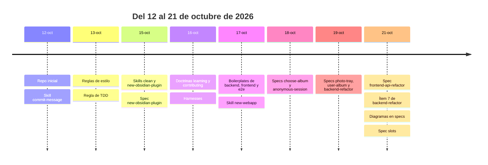
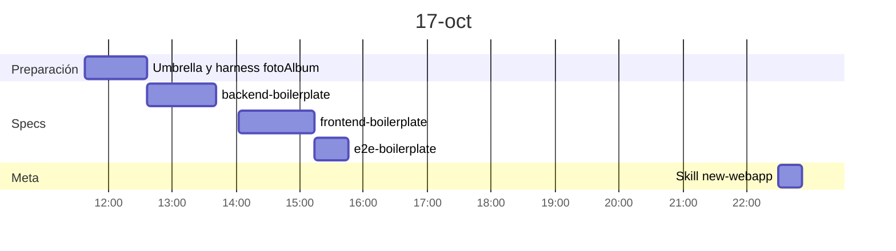
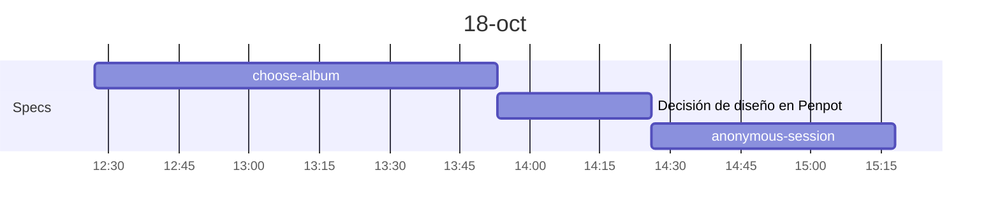
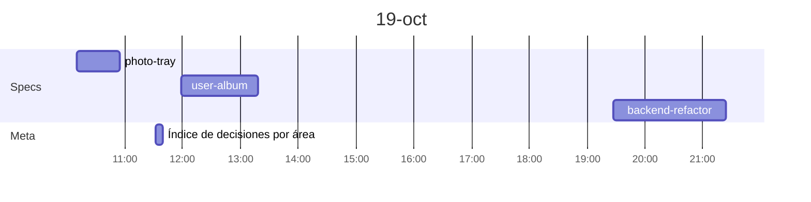
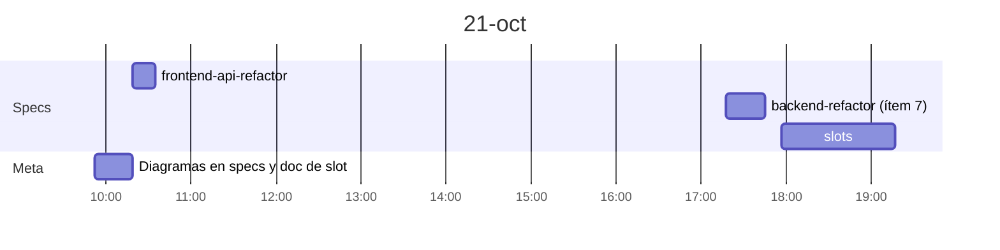

# Timeline de specs de fotoAlbum

Horas sacadas de los commits de PrometeuZZ y de los subrepos de `Sandbox/fotoAlbum`. Son horas de commit, no de trabajo: la ventana real puede ser algo mayor y las pausas no se descuentan.

## Visión general

## 17 de octubre: boilerplates

## 18 de octubre: primeras slices

## 19 de octubre: slices y refactor

## 21 de octubre: refactor del frontend, cierre del backend y slots

## Resumen

| Spec | Día | Inicio | Fin | Duración aprox. |
|------|-----|--------|-----|-----------------|
| backend-boilerplate | 17-oct | 12:37 | 13:41 | 1 h |
| frontend-boilerplate | 17-oct | 14:03 | 15:14 | 1 h 10 min |
| e2e-boilerplate | 17-oct | 15:14 | 15:46 | 30 min |
| choose-album | 18-oct | 12:27 | 13:53 | 1 h 30 min |
| anonymous-session | 18-oct | 14:26 | 15:18 | 50 min |
| photo-tray | 19-oct | 10:10 | 10:55 | 45 min |
| user-album | 19-oct | 11:58 | 13:18 | 1 h 20 min |
| backend-refactor | 19-oct | 19:27 | 21:24 | 2 h |
| frontend-api-refactor | 21-oct | 10:19 | 10:35 | 16 min |
| backend-refactor (ítem 7) | 21-oct | 17:18 | 17:45 | 27 min |
| slots | 21-oct | 17:57 | 19:17 | 1 h 20 min |
