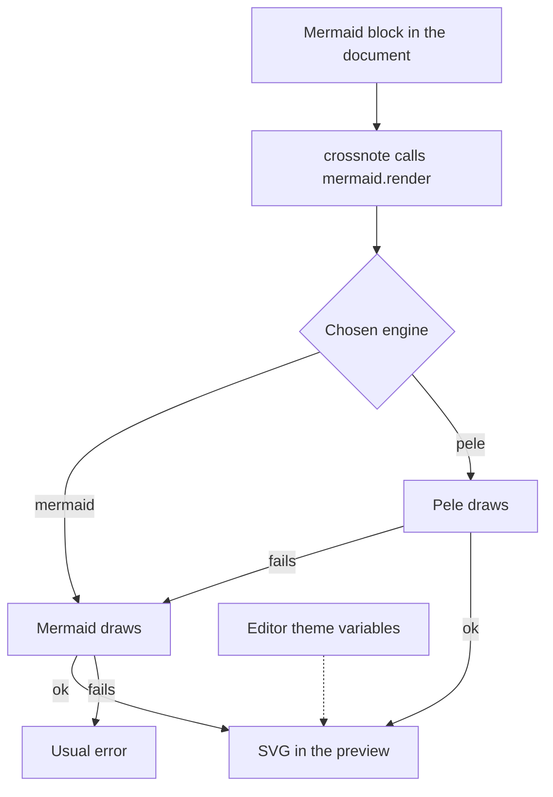

# Mermaid engine: Pele

Docs touched: `.claude/docs/mermaid-engine.md`. Decisions: `.claude/decisions.md`, areas Integration, Behavior, Theme, Scope and tests.

Mark a step `- [x]` when its tests, lint and build pass (`make test`, `make check`, `make build`). A step tried by hand is marked only after Xavier confirms.

## Facts to verify while building

- crossnote's webview calls `window.mermaid.render(id, code)` and reads `{ svg }` from the result (seen in `node_modules/crossnote/out/webview/preview.js`).
- Pele's `render(source, options)` is sync, takes no id and returns `{ svg, ... }`; it measures text with a canvas, so it needs a browser. A thin `PeleRenderer` in `src/webview/mermaid-engine-entry.ts` adapts it to `DiagramRenderer`. Verified in step 3.
- Step 3 builds the bundle to `crossnote/webview/mermaid-engine.js` (gulp recreates that folder first) and the entry reads the engine from `document.currentScript.dataset.engine`, defaulting to `mermaid`. Step 4 decides how the preview HTML sets it.
- Crossnote's preview HTML loads its Mermaid, then the `scripts` option, then `preview.js`. We pass our tag through `scripts` in `src/preview-provider.ts`, so it loads after Mermaid. Verified in step 4.

## Steps

- [x] 1. Engine setting. Add the setting (`mermaid`, `pele`; default `mermaid`) to `package.json` and every `package.nls*.json`, and read it in `src/config.ts`. The description says the Mermaid theme and configuration settings do not apply with Pele. Test: the default is `mermaid`; `pele` is read.
- [x] 2. Adapter with fakes (`*Strategy` per engine). Cycles, each test-first:
  1. Mermaid chosen: Mermaid draws, Pele is never called.
  2. Pele chosen: Pele's `{ svg }` is returned.
  3. Pele throws: Mermaid draws that diagram.
  4. Both throw: the error is Mermaid's, unchanged.
  Close with the `extract-sut` skill.
- [x] 3. Dependency and bundle. Add `pele` as a `devDependency`, bundle the adapter and Pele into one webview script in `build.js`, and copy it where `gulpfile.js` packages webview assets. Check the build on Node 18 through the `Makefile`.
- [x] 4. Load in the preview. Inject the script after crossnote's Mermaid in the preview HTML and pass the chosen engine to it. Tried by hand: one document with a flowchart and a sequence diagram, engine `pele`, then `mermaid`.
- [ ] 5. Theme. Bind Pele's CSS variables to `--vscode-*`. Tried by hand: switch the editor between light and dark with a preview open.
- [ ] 6. Close. Add the README note and the `CHANGELOG.md` entry that `AGENTS.md` asks for.

## Diagram

